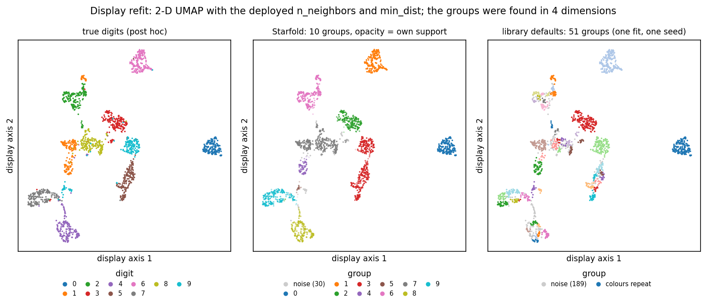

# Starfold

Starfold finds groups in a numeric table without labels, then tells you how far to trust them. It is for anyone with a table (one row per object, one column per measurement) who wants groups that hold up when the rows change. It tunes two standard methods: UMAP, which draws the table as a low-dimensional map that keeps close rows close, and HDBSCAN, which finds dense clumps on that map and leaves sparse rows unassigned as noise. Optuna, a tuning library, chooses the settings to try, starting with the library defaults. Each setting is scored without labels: its groups must predict rows the fit never saw, it must assign most rows, and its groups must be close neighbours in your original columns. Each score is compared with the same setting on a structureless copy of your table, which keeps every column's values and correlations but has no groups. Starfold fits the best setting on all rows, then refits it on 32 random subsets of 80 percent of the rows to see how often each row and group comes back. Whatever the evidence does not support comes back as a flag, a short named warning.



*The scikit-learn digits dataset on a 2-D UMAP display. It is a copy of the UCI handwritten digits test set: 1,797 images of 8 by 8 pixels, one per row, with 64 pixel columns. Left: the true digits, which Starfold never sees. Middle: Starfold's groups, faded where the refits rarely agree. Right: the UMAP and HDBSCAN defaults.*

## Install

You need Python 3.11 or 3.12.

```bash
pip install "starfold @ git+https://github.com/AndreasWNeitzel/starfold"             # CPU
pip install "starfold[gpu-cu13] @ git+https://github.com/AndreasWNeitzel/starfold"   # NVIDIA GPU, CUDA 13
pip install "starfold[gpu-cu12] @ git+https://github.com/AndreasWNeitzel/starfold"   # NVIDIA GPU, CUDA 12
```

The GPU extras install RAPIDS cuML, NVIDIA's GPU versions of UMAP and HDBSCAN (Linux or WSL2 only). Pick the one that matches the CUDA version `nvidia-smi` reports. Only the final consensus cut then runs on the CPU. The [install page](https://andreaswneitzel.github.io/Starfold/start/install.html) has the details.

## First run

These five lines run the whole procedure on the scikit-learn digits dataset. `random_state=0` is the seed: the number every random choice starts from, so a rerun gives the same result.

```python
import starfold
from sklearn.datasets import load_digits
X = load_digits().data
result = starfold.recover(X, random_state=0)
print(result.flags, result.n_groups, result.worlds.count_interval, f"{result.unresolved_mass:.3f}")
```

The recorded run (cuML engine) prints:

```text
('search_budget_exhausted', 'count_unstable', 'consensus_disagrees', 'null_not_run') 10 (3, 16) 0.044
```

Read the flags first: here the refits disagree on the number of groups, so do not quote one count. `10` is the number of groups in the fit on all rows. `(3, 16)` is the 5 to 95 percent range of group counts over the refits, a stability interval (how much the result moves when the rows change), not a confidence interval. `0.044` is the unresolved mass: the average share of refits in which a row did not keep its group. Other engines, machines or versions can print other numbers. The [first-run page](https://andreaswneitzel.github.io/Starfold/start/first-run.html) explains every item.

To keep the result, call `starfold.save(result, "runs/digits")`; `starfold.load("runs/digits")` reads it back.

## What a result holds

| attribute | meaning |
|---|---|
| `labels`, `kept_rows` | one fit of the selected settings on all rows; `-1` means unassigned; rows with NaN or inf are dropped, never filled in |
| `params`, `deployed_params` | the selected settings, and the same settings with `min_cluster_size` and `min_samples` scaled to the full row count |
| `default_labels`, `default_params` | the UMAP and HDBSCAN defaults on the same rows, for comparison |
| `support`, `worlds.unresolved` | per row: how often the refits that sampled it put it with each group, or with none; each row sums to one |
| `worlds.group_recurrence`, `worlds.group_recurrence_band` | per group: how well it comes back across refits (0 to 1), and its 5 to 95 percent range |
| `worlds.count_values`, `worlds.count_interval` | groups found in each refit, and their 5 to 95 percent range |
| `worlds.property_median`, `worlds.property_band` | per group and column: the median in your units, and its spread over refits |
| `consensus.contrast`, `consensus.agreement` | how much more often the refits put rows of one group together than rows of different groups; how well a partition cut from that matches `labels` |
| `null` | the calibration test, when `Config.null_families` names a family; skipped by default |
| `search.trials`, `search.candidates` | every setting tried (each one is a trial) with its score; the best few rescored on fresh subsets |
| `flags`, `provenance` | caveats; seeds, versions, engine, budgets, fits and seconds per stage |

`engine="auto"` uses cuML when it can and warns when it falls back to the CPU; `engine="cuml"` raises instead. On the CPU, `n_jobs` sets the worker count. Pass real per-value uncertainties as `X_err` (same shape as `X`) and every refit redraws the table from them.

## The calibration test

The calibration test asks whether structureless copies of your table score as high as the real one; a small p-value means few do. `recover` skips it by default because of its cost: 102 fits per copy at the default settings, with up to 19 copies (1,938 fits), about six times the fits of the rest of a run. Run it once, on the result you report, with the same `config`, `random_state` and `engine` that `recover` used:

```python
null = starfold.null_test(X[result.kept_rows], result.search, random_state=0)
print(null.p_value, null.structure_supported)
```

To run it inside `recover` instead, pass `config=starfold.Config(null_families=("gaussian_copula",))` and read `result.null.p_value`. With the test off, the recorded digits run makes 314 fits (93.9 s on a laptop RTX 3060 with cuML). The test itself adds up to 1,938 fits, and the recorded digits test took 791 s.

## Reading the flags

`result.flags` names every caveat the evidence raised, from a fixed list of 17 (`starfold.result.FLAG_VOCABULARY`). `starfold.load` recomputes them from the stored arrays instead of trusting the saved list. The most common:

- `search_stopped_early` or `search_budget_exhausted`: one of the two is always present and says only how the search ended.
- `null_not_run`: the calibration test did not run inside `recover` (the default). A separate `null_test` returns its own evidence and leaves this flag in place.
- `selected_is_default`, `default_within_noise`: the search found nothing better than the defaults, or nothing better beyond the noise of the score.
- `count_unstable`, `high_unresolved_mass`: most refits find a different number of groups than `labels` has, or rows are on average left unassigned in more than half the refits.
- `consensus_disagrees`: the partition cut from the refits agrees poorly with `labels`.
- `no_structure_supported`: the calibration test ran and its p-value is above `alpha`.

The manual's [flag reference](https://andreaswneitzel.github.io/Starfold/reference/flags.html) lists all 17, each with its meaning and what to do about it.

## Scope and limits

- You need one row per object, with at least 50 finite rows and 2 numeric columns. The columns you choose define what "similar" means. Starfold scales them; use `Config(scaling="robust")` for heavy tails. Rows with a missing value are dropped, never filled in.
- Groups much smaller than about sqrt(12 n) rows (about 155 rows at n = 2,000 and 350 at n = 10,000) tend to be merged into larger ones. This is a rule of thumb measured on our benchmark and by injecting groups into a real table, not a derived bound.
- A stable group is not a true group. Support is how often the refits agree, not the probability that a row belongs to a group. The ranges over refits are stability intervals, not confidence intervals. A dense chance fluctuation also comes back in every subset. There is no per-group significance test.
- The group count is not an estimate of how many populations exist. On our benchmark it can differ from the true class count (Gas drift: 390 groups against 6 classes; Letter: 284 against 26). Report `worlds.count_interval` with it.
- The p-value of the calibration test holds only for its family of copies (by default a Gaussian copula: one population with the table's column values and correlations). It also holds only for the part of the search it replays: by default the library defaults and the 16 Sobol points that open the search, and the best score among them. `Config(null_procedure="full_search")` replays the whole search at a higher cost. With 19 copies the p-value cannot go below 0.05. It is not the probability that the groups are real.
- We compared Starfold and the UMAP and HDBSCAN defaults with the true classes of ten labelled public tables. The score is the adjusted Rand index (1 for identical groupings, near 0 for chance) on the assigned rows, times the share assigned. We used six tables to tune the method and held four out. Starfold matched or beat the defaults (within 0.02 counts as a match) on 8 of the ten: all six development tables and two of the four held out. On the four held-out tables, however, its mean was lower than the defaults' (0.24 against 0.29). The largest table has 20,000 rows; nothing larger has been measured. CPU and GPU runs do not give identical labels; compare them by partition with `starfold.compare_backends`. The [limits page](https://andreaswneitzel.github.io/Starfold/limits.html) gives the full list.

## Learn more

The [manual](https://andreaswneitzel.github.io/Starfold/):

- [Concepts](https://andreaswneitzel.github.io/Starfold/concepts/index.html): what happens inside `recover`.
- [Tutorial](https://andreaswneitzel.github.io/Starfold/tutorial/index.html): the digits and APOGEE examples, every output explained.
- [Metrics](https://andreaswneitzel.github.io/Starfold/metrics/index.html): what each printed number means.
- [How-to guides](https://andreaswneitzel.github.io/Starfold/howto/index.html): your own table, scaling, the GPU, the calibration test, reporting.
- [Flags](https://andreaswneitzel.github.io/Starfold/reference/flags.html) and [glossary](https://andreaswneitzel.github.io/Starfold/glossary.html).

Notebooks, with their recorded outputs: [the scikit-learn digits dataset](notebooks/01_digits.ipynb), [the APOGEE DR19 example table](notebooks/02_apogee.ipynb), [the calibration test](notebooks/03_calibration.ipynb). The APOGEE table ships with the repository, not the package ([provenance](bench/data/stellar_chemokinematics_apogee_dr19.md)). Changes between versions are in the [changelog](CHANGELOG.md).

## Tests

```bash
git clone https://github.com/AndreasWNeitzel/starfold && cd starfold
uv sync --extra dev --extra bench    # add --extra gpu-cu13 or --extra gpu-cu12 for cuML
uv run pytest -m "not slow"          # quick checks
uv run pytest -m slow                # real fits on small fixtures
STARFOLD_TEST_CUML=1 uv run pytest -m gpu   # needs cuML
```

## Citation

Cite the software ([CITATION.cff](CITATION.cff)) and the paper it grew from:

Neitzel, A. W., Campante, T. L., Bossini, D., and Miglio, A. 2025, "Dissecting stellar populations with manifold learning. I. Validation of the method on a synthetic Milky Way-like galaxy", A&A, 695, A243, doi:10.1051/0004-6361/202451718

Please also cite UMAP (McInnes, Healy and Melville 2018, arXiv:1802.03426), HDBSCAN (Campello, Moulavi and Sander 2013, doi:10.1007/978-3-642-37456-2_14) and Optuna (Akiba et al. 2019, arXiv:1907.10902). The [citing page](https://andreaswneitzel.github.io/Starfold/citing.html) has BibTeX for all of them.

## License

MIT, see [LICENSE](LICENSE).
