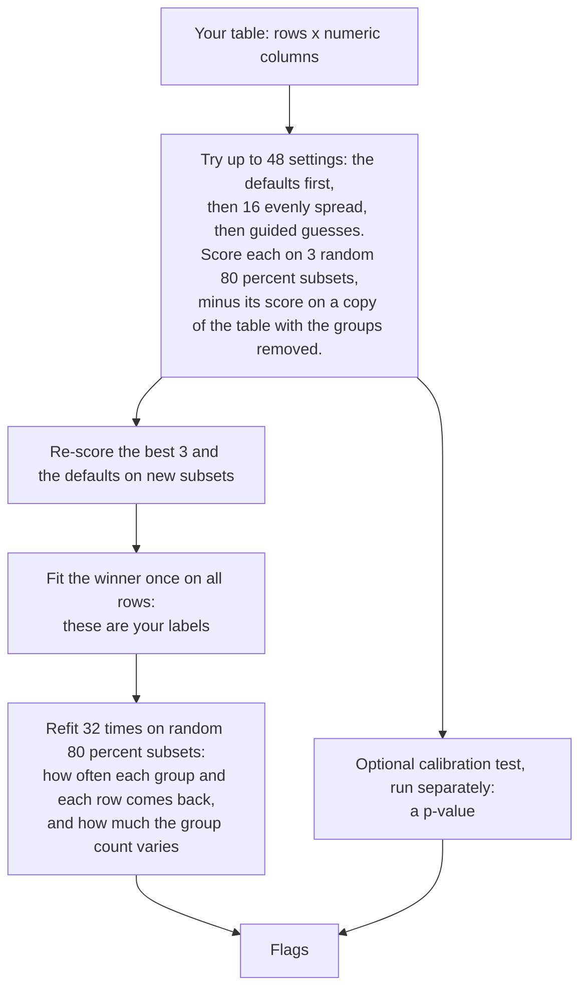
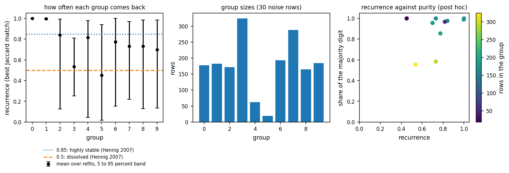
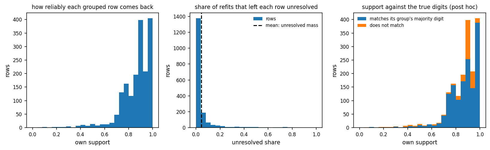
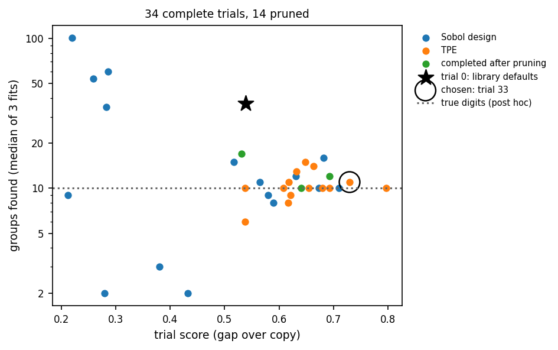
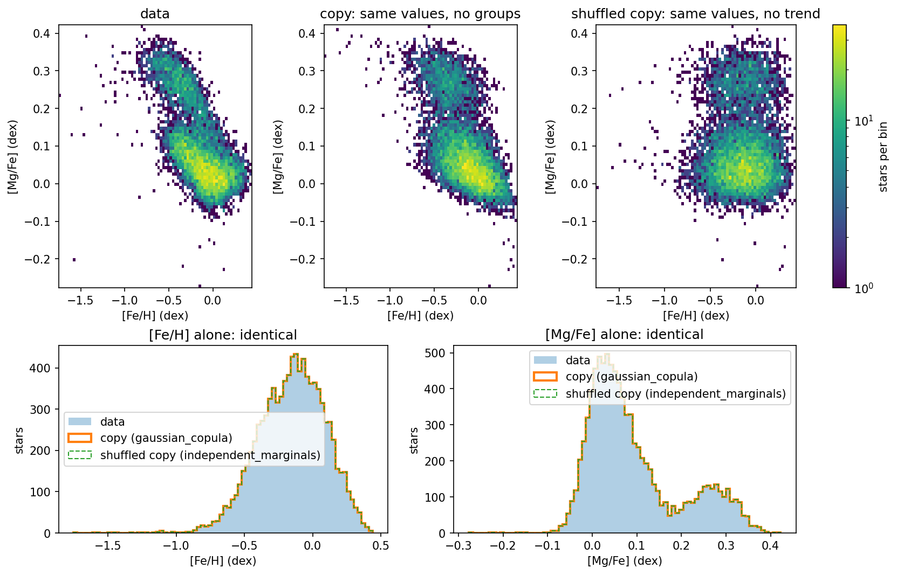
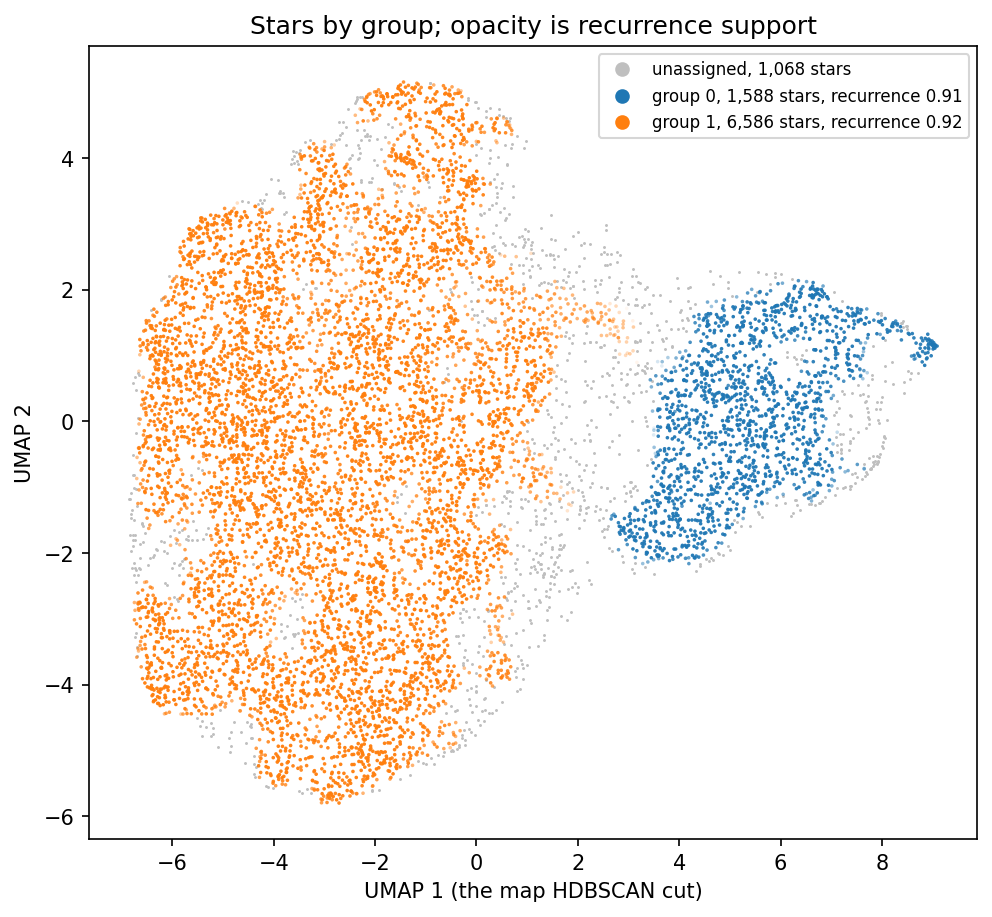
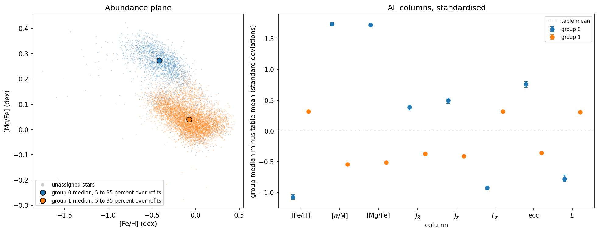
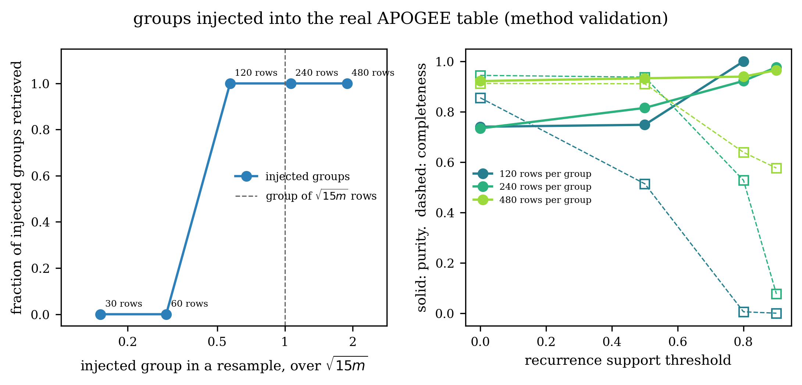
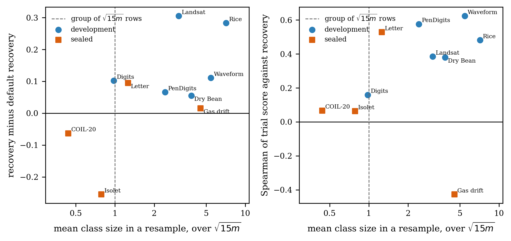

# The Starfold handbook

## 1. What Starfold does

You give Starfold a numeric table: one row per object (a star, a cell, an image), one column per
measured number. It returns one set of groups, how often each group and each row comes back when it
refits on random subsets of the rows, and a flag wherever the evidence is weak. It never sees any
known classes your rows may have. Three tools do the work:

- **UMAP** (McInnes, Healy and Melville 2018) draws a low-dimensional map of the table, the
  *embedding*, that keeps similar rows close together.
- **HDBSCAN** (Campello, Moulavi and Sander 2013; implementation by McInnes and Healy 2017) finds
  dense clumps in the map. Each clump is a *group*; rows between clumps are *noise*, labelled -1.
- **Optuna** (Akiba et al. 2019) searches the settings of both, because the settings decide the
  answer.


*Handwritten digits (1,797 rows, 64 pixels) on a 2-D display map. Left, the true digits, never seen by
Starfold. Middle, Starfold's groups, faded where support is low. Right, the library defaults.*



---

## 2. Install and first run

Starfold needs Python 3.11 or 3.12.

```bash
pip install "starfold @ git+https://github.com/AndreasWNeitzel/starfold"             # CPU
pip install "starfold[gpu-cu13] @ git+https://github.com/AndreasWNeitzel/starfold"   # NVIDIA GPU, CUDA 13
pip install "starfold[gpu-cu12] @ git+https://github.com/AndreasWNeitzel/starfold"   # NVIDIA GPU, CUDA 12
```

The GPU extras install RAPIDS cuML (NVIDIA's GPU versions of UMAP and HDBSCAN) on Linux or WSL2.
`nvidia-smi` shows the highest CUDA version your driver supports; the CUDA 12 extra needs driver
525.60.13 or newer, the CUDA 13 extra 580.65.06 or newer (docs.rapids.ai/install). Install one,
never both: they pin different CUDA toolkits and `uv` refuses the pair. The notebooks and the
bundled APOGEE table need a clone:

```bash
git clone https://github.com/AndreasWNeitzel/starfold && cd starfold
uv sync --extra bench                  # add --extra gpu-cu13 or --extra gpu-cu12 for cuML
```

A first run on the handwritten digits:

```python
import starfold
from sklearn.datasets import load_digits

X = load_digits().data                 # 1,797 rows, 64 columns; the digit classes are not used
result = starfold.recover(X, random_state=0)

print(result.flags)                    # read these first
print(result.n_groups, result.worlds.count_interval, result.unresolved_mass)
labels = result.labels                 # one entry per row in result.kept_rows; -1 is noise

starfold.save(result, "runs/digits")
result = starfold.load("runs/digits")  # checks the files and re-derives the flags
```

- **The calibration test is off by default**, so the result carries `null_not_run`. It costs about
  six times the rest of a run; run it once, on the result you report (section 6).
- **`engine="auto"`** uses cuML when it imports and sees a GPU, and otherwise warns and runs on the CPU;
  `"cuml"` raises instead, and `"cpu"` never touches the GPU.

The [digits notebook](../notebooks/01_digits.py) walks through this run.

---

## 3. Preparing your table

Starfold compares rows by distance after scaling each column, so the columns you choose define what
"similar" means.

- **One row per object, numbers only.** A star listed twice counts twice, so remove duplicates. Leave
  categorical columns out (a category coded 0, 1, 2 is not a distance) or run within each category.
- **At least 50 rows and 2 columns**, or `recover` raises a `ValueError`. With `n` rows kept, groups
  much smaller than about sqrt(12 n) rows tend to merge (section 8).
- **Missing values drop the row.** A row with a NaN or infinity anywhere is removed, never filled in
  (flag `rows_rejected_nonfinite`), so `X[result.kept_rows]` lines up with `result.labels`. Filling gaps
  with a column mean makes a false dense clump that Starfold will call a group; if a column is missing
  for most rows, drop the column.
- **Choose columns for the question.** Every column gets equal weight after scaling. An irrelevant
  column blurs real groups; two columns measuring the same thing count it twice.
- **Scaling** is fitted inside each subset (scikit-learn; Pedregosa et al. 2011).
  `Config(scaling="standard")` divides by the standard deviation; `Config(scaling="robust")` uses the
  median and interquartile range, better when a few extreme values squash the rest of a column.
- **Uncertainties.** Measured per-value uncertainties go in as `X_err` (standard deviations, the shape
  of `X`, finite and non-negative on every kept row); every refit draws `X + X_err * N(0, 1)`. For
  correlated errors pass `measurement_sampler(rows, indices, rng)`, which returns a perturbed copy of
  `rows`; give one or the other. They change the 32 refits, not the choice of settings, and an invented
  error bar produces an invented spread.

---

## 4. Reading a result

Read `result.flags` first (table at the end of this section), then check whether the count, the groups
and the rows are stable. A *refit* (or *world*) is one fit of the selected settings on a random 80
percent of the rows; Starfold runs 32. The *full fit* uses all rows and gives `result.labels`; its set
of groups is the *partition*. Every number below is a recurrence rate or a stability range over the
refits, not a probability or a confidence interval. *Post hoc* marks a check against known classes
that Starfold never saw.

**The count.** Compare `result.n_groups` with `result.worlds.count_interval`, the 5th to 95th
percentile of the groups found per refit (`count_values` holds all 32). A narrow interval containing
`n_groups` means the count reproduces; a wide one means the table supports several readings. Neither
estimates how many populations exist.


*Groups found by each of the 32 Digits refits, with the full fit's count and the true count (post hoc).*

**Unresolved mass.** `result.unresolved_mass` is the average share of refits that left a row unassigned
or put it with rows the full fit calls noise. Above 0.5 (`high_unresolved_mass`) the groups describe a
minority of rows, which is honest for a table with a diffuse background.

**The groups.** `result.worlds.group_recurrence` gives each group a number from 0 to 1: per refit, the
best Jaccard overlap (shared rows over rows in either) between the group and any refit group, averaged
over refits; `group_recurrence_band` is its 5th to 95th percentile. Hennig (2007) reads above 0.85 as
stable and below 0.5 as dissolved; Starfold quotes those marks and never uses them to drop a group.
`property_median` and `property_band` give each group's median per column in your units, with its range
over refits.



*Left, recurrence of each Digits group. Middle, group sizes. Right, recurrence against the share of
the group's majority digit (post hoc).*

**The rows.** `result.support[i, g]` is how often, across the refits that sampled row `i`, it landed
in a refit group made of members of group `g`. `result.worlds.unresolved` holds the rest, so each
row sums to one, and `own_support` picks each row's own group. Keeping rows with own support above
0.9 gives a purer sample and loses rows near the edges (section 8 shows how steep the trade can be).



*Left, own support of every grouped Digits row. Middle, the unresolved share. Right, own support by
whether the row matches its group's majority digit (post hoc).*

**The co-association check.** For each pair of rows, `result.consensus` takes the share of refits that
grouped both together among those that assigned both. `contrast` is that share averaged over pairs in
one group minus its average over pairs in different groups: near 1 the refits agree with your
partition, near 0 they do not. The check also regroups the rows from these shares alone and compares
the result with `labels`; with 32 refits many pairs tie, so that regrouping can fail and raise
`consensus_disagrees` although the refits agree, so read the contrast first. Above 5,792 rows it runs
on a recorded 4,096-row subset (`consensus_subsampled`). The p-value (`result.null.p_value`, 1.0 until
the test runs) is in section 6.

### All 16 flags

| flag | fires when | what it means | what to do |
|---|---|---|---|
| `search_stopped_early` | the best score improved by less than 0.01 over 16 trials | the search converged before 48 trials | |
| `search_budget_exhausted` | all 48 trials ran | the search was still improving | raise `n_trials` if the score matters |
| `selected_is_default` | the library defaults won the fresh re-score | no searched setting did better | report it; the defaults are a fine answer |
| `default_within_noise` | the selected and default fresh scores differ by at most twice the standard error of their six paired differences (never raised when the defaults were selected) | the win over the defaults is within noise | do not claim the search improved on the defaults |
| `no_groups_in_reference` | the full fit labels every row -1 | no group was found | check columns and scaling (section 3); lower the `min_cluster_size` range in `Space` |
| `high_unresolved_mass` | unresolved mass is above 0.5 | most rows are not reproducibly grouped | describe groups as a minority of the table |
| `count_unstable` | fewer than half the refits find `n_groups` groups | the count is not reproducible | quote `count_interval`, not `n_groups`; drop irrelevant columns |
| `world_fit_failures` | a refit raised an error | some refits count as all noise | read `worlds.world_errors` |
| `consensus_subsampled` | the co-association matrix does not fit `consensus_budget_bytes` (above 5,792 rows at the default 512 MiB) | the check used a 4,096-row subset | |
| `consensus_disagrees` | the regrouping from co-association agrees with `labels` below 0.5 | the regrouping failed or disagrees | read `consensus.contrast`; if it is high, trust it |
| `null_not_run` | no calibration test ran | there is no p-value | run `starfold.null_test` (section 6) |
| `observed_statistic_zero` | the best exploration gap on your table is zero or below | the search found no setting that beats the copy | check columns and scaling (section 3); report that no structure was found |
| `no_structure_supported` | the test ran and p is above `alpha` (0.05 by default) | copies without groups scored as high | report the groups as reproducible, not as shown to exceed the copy (section 7) |
| `backend_disagreement` | CPU and GPU normalised agreement is below 0.8 (section 9) | the answer depends on the backend | compare partitions, report both |
| `rows_rejected_nonfinite` | some rows held NaN or infinity | those rows were dropped | check `kept_rows` |
| `n_jobs_forced_to_one_on_cuml` | `n_jobs` (CPU worker processes) was above 1 on cuML | the GPU runs one fit at a time | |

Flags are derived from the arrays; `starfold.load` derives them again and refuses a file whose
stored flags differ.

---

## 5. How the settings are chosen

Settings alone can change how many groups the same table gives, from a handful to hundreds. Starfold
scores each setting on rows its fit never saw and subtracts what the same setting scores on a copy of
your table with the groups removed. Only the excess counts.



*Every complete Digits trial: gap over the copy against the median groups its three fits found. Trial 0
is the black star, the selected trial is circled, the dotted line marks the 10 true digits (post hoc).*

| setting | what it controls | searched range | default |
|---|---|---|---|
| `n_neighbors` | how many neighbours UMAP looks at; small values see fine detail | 5 to 100, log scale (at most subset size minus 1) | 15 |
| `min_dist` | how tightly UMAP packs similar rows | 0.0 to 0.5 | 0.1 |
| `n_components` | how many coordinates the map has | 2 to 10 | 2 |
| `min_cluster_size` | the smallest clump HDBSCAN may call a group | 5 to min(max(50, n/20 rounded down), 1023), log scale | 5 |
| `min_samples` | how smooth HDBSCAN's density estimate is; larger values call more rows noise | 0.05 to 1.0 of `min_cluster_size`, log scale | 5 |
| `selection_method` | `eom` picks the most persistent clumps, `leaf` the finest ones | `eom`, `leaf` | `eom` |

`starfold.Space` sets these ranges. The cap of 1023 comes from cuML's limit on `min_samples`, so CPU
and GPU search the same space.

### The score

Starfold draws three random 80 percent subsets, and every setting is scored on the same three, so a
difference between settings comes from the settings and not from the draw (common random numbers;
Glasserman and Yao 1992). For one setting, UMAP and HDBSCAN are fitted on each subset and three
things are measured:

1. **Prediction agreement.** For each row of subset B that the fit on subset A never saw, predict a
   group from the 15 most similar rows A did see and compare with the fit on B (adjusted Rand index: 1
   for identical groupings, 0 for chance). A setting that tears a smooth region into small clumps cannot
   predict unseen rows (Lange et al. 2004; Tibshirani and Walther 2005).
2. **Coverage.** The share of those rows that both fits assigned to a group, so calling most rows
   noise does not pay.
3. **Modularity.** Link each row to its 15 nearest rows in your scaled columns, before any map is
   drawn, and measure how many links stay inside groups compared with chance (Newman 2006). A
   separation UMAP invents earns nothing (Chari and Pachter 2023), and modularity offsets the pull of
   agreement alone towards the coarsest grouping (von Luxburg 2010).

The score is the cube root of the product, so a zero in any one gives zero (all noise, one giant
group, a crashed fit) without a special rule. It never looks at the number of groups.

### The copy and the gap

Some settings score well on any table, including one with no groups: chopping a smooth cloud into
compact pieces gives pieces that recur and look tidy. Starfold therefore builds a structureless copy
of your table that keeps every column's values and the correlations between columns but reorders
which values sit together, so the copy is one smooth cloud (a *Gaussian copula*; Appendix A). Every
number in it is one you measured.



*[Fe/H] against [Mg/Fe] for the 9,242 APOGEE stars of section 7 (top left), a Gaussian-copula copy
(top middle) and a shuffled copy (top right). Below, each column alone: identical histograms, because
a copy only reorders measured values. Do the two dense ridges survive in the copies?*

Each setting is scored on the data and on the copy with the same subsets, and the search maximises the
difference, the *gap* (Tibshirani, Walther and Hastie 2001). A setting that only chops scores about
the same on both and gains nothing.


*Every complete APOGEE trial, scored on the data (x) and on the copy (y). Points on the diagonal have
no advantage over structureless data; the further below, the larger the advantage. The defaults are
the black star
(0.326 on the data, 0.319 on the copy)
and the selected trial is circled.*

### The search and the final fit

- **Trial 0 is the library defaults** (a default outside your `Space` moves to the nearest bound), so
  Starfold always considers the answer you would get without it.
- **Trials 1 to 16 are a scrambled Sobol design**: points that cover the space far more evenly than
  random draws (Owen 1998; Bergstra and Bengio 2012). They are never cut short.
- **Later trials use TPE** (tree-structured Parzen estimator), which learns which regions scored well
  and proposes points there (Bergstra et al. 2011).
- **Pruning and stopping.** From trial 17, a trial whose data score after two of its three fits is
  below the median of earlier complete trials stops (Golovin et al. 2017); up to 3 pruned trials whose
  partial score beats the best complete trial are finished at the end. From trial 33, the search stops
  when the best score has improved by less than 0.01 over 16 trials.

The best score of 48 noisy trials is optimistic, since the top trial is partly lucky. Starfold
re-scores the top 3 complete trials and the defaults on three fresh subsets and three fresh copies and
selects the largest fresh gap, ties to the defaults (`result.search.candidates`; `result.search.trials`
holds every trial). The winner is fitted once on all rows: `result.labels` is one transparent fit,
not a vote. `min_cluster_size` and `min_samples` are row counts validated on subsets of `m = 0.8 n`
rows, so the full fit multiplies both by `n / m`. `result.params` holds the searched values and
`result.deployed_params` the rescaled ones.

---

## 6. The calibration test

The p-value is the chance that structureless copies of your table, run through the first 17 trials of
the same search, score at least as high as your table. It is not the probability that the groups are
real and says nothing about how many there are. Run it once, on the result you report.

The *statistic* is the best gap among the 17 opening trials (trial 0 and the 16 Sobol points), stored
as `result.search.exploration_max`. The test runs the same 17 trials on a copy of your table with the
same seeds and records the copy's best gap, for up to 19 copies. With `h` copies at or above your
table out of `L` drawn, `p = (h + 1) / (L + 1)`, so with 19 copies p cannot go below 0.05. It stops
once 3 copies reach your table's value. `null.p_intervals` gives the share of copies at or above your
table with a range showing how precisely 19 copies pin it down. Each trial's score is itself a gap, so
each copy needs a second copy of its own: 17 trials x 3 subsets x 2 tables = 102 fits per copy, up to
1,938 fits, about six times the rest of a run.

`gaussian_copula` (the default) is one smooth population with your columns' values and correlations.
Groups that show up only as a correlation between columns survive in it, so it can score almost as high
as your table. `independent_marginals` shuffles each column alone, destroying every correlation
(Lövdal et al. 2022), and is easier to beat. With several families, `p_value` is the largest of their
p-values. `Config(null_procedure="full_search")` replays the whole search instead of the 17 opening
trials, at a much higher cost. Run the test on the rows `recover` kept, with the same `config`
(including any custom `Space`), `random_state` and `engine` and, above 20,000 rows per subset, the
same `n_jobs`:

```python
null = starfold.null_test(X[result.kept_rows], result.search, random_state=0)
print(null.p_value, null.p_intervals, null.structure_supported)
```

A separate `null_test` returns its own evidence and leaves `null_not_run` on the result; the
[calibration notebook](../notebooks/03_calibration.py) shows how to attach it and re-derive the flags.
To run it inside `recover`, pass `Config(null_families=("gaussian_copula",))`.

Results on two tables, 19 copies each:

| table | what it is | p | copies at or above the table | notes |
|---|---|---:|---:|---|
| Digits | 1,797 rows, 10 digit classes | 0.050 | 0 of 19 | table 0.710, largest copy 0.243; interval 0 to 0.176 |
| APOGEE | 9,242 stars, no classes | 0.100 | 1 of 19 | table 0.362, exceeding copy 0.366, copy median 0.165; interval 0.001 to 0.260 |

The records are `bench/results/digits_null.json` and `bench/results/apogee_null.json`.

---

## 7. Worked example: 9,242 APOGEE DR19 stars

A full run without known classes on the table bundled with the repository, and how to report it. The
[APOGEE notebook](../notebooks/02_apogee.py) reproduces it and draws the figures. Each star has three
chemical abundances ([Fe/H], [alpha/M], [Mg/Fe] from the APOGEE DR19 ASPCAP pipeline) and five orbital
quantities integrated with galpy from Gaia DR3 (radial action `J_R`, vertical action `J_z`, angular
momentum `L_z`, eccentricity, orbital energy); see the
[provenance note](../bench/data/stellar_chemokinematics_apogee_dr19.md). `bench.datasets.example_table()`
loads the table and checks its checksum.

This is a check of the method, not a finding about the Galaxy. Disc stars fall on two chemical
sequences: at the same iron content, one is richer in alpha elements such as magnesium (high-alpha),
the other poorer (low-alpha). A method that finds no structure here, or fifty groups, has a problem.

| quantity | value |
|---|---|
| groups (`n_groups`) and their sizes | 2 groups, of 1,588 and 6,586 stars |
| unassigned stars | 1,068 of 9,242 |
| count interval over 32 refits | 2 to 2 |
| unresolved mass | 0.154 |
| group recurrence | 0.91 (0.89 to 0.94) and 0.92 (0.88 to 0.94) |
| fresh gap, selected against defaults | 0.372 against -0.001 |
| co-association within, between, contrast | 0.979, 0.003, 0.976 |
| co-association regrouping agreement | 0.0 (the cut returned all 4,096 subset stars as noise) |
| calibration test | p = 0.100, 1 of 19 copies at or above the table, interval 0.001 to 0.260 |
| flags | `search_budget_exhausted`, `consensus_subsampled`, `consensus_disagrees`, and `no_structure_supported` once the test is attached (`null_not_run` before) |

The fresh gap comes from the re-scoring step of section 5, on new subsets and copies. The calibration
row is `bench/results/apogee_null.json` (statistic `exploration_design_max` 0.362).



*Stars in the map, coloured by group; faint stars rarely stay in their group across refits. If the
chosen map has more than two coordinates this is a separate 2-D map for display.*



*Left, group medians in the [Fe/H] against [Mg/Fe] plane with 5 to 95 percent bands over refits. Right,
every column's group median in standard deviations from the table mean.*

The group medians sit at
[Fe/H] = -0.416 (-0.424 to -0.405) and [Mg/Fe] = +0.273 (0.271 to 0.275) dex for the 1,588-star group, and -0.076 (-0.080 to -0.071) and +0.040 (0.039 to 0.042) dex for the 6,586-star group. Compare them with
the known positions of the two sequences; Starfold was given no classes, no astronomy and no expected
count.

### How to report it

The calibration test gives p = 0.10, so the split is not shown to beat a Gaussian-copula copy that
keeps the correlations (`no_structure_supported`). This run cannot separate three reasons: the statistic
uses only the 17 opening trials and has less power than the full search; with 19 copies p moves in steps
of 0.05 and one copy (0.366 against 0.362) decided the outcome; and the copy keeps the correlations
between iron, magnesium and the orbits, which carry much of the two-sequence signal.

Suggested wording for a paper: "Starfold recovers
2 groups with recurrence
0.91 and 0.92 across 32 refits, whose medians lie on
the high-alpha and low-alpha sequences; a matched
Gaussian-copula test gives p = 0.10 (19 copies), so the split is not shown to exceed a single
correlated population." State the claim about the sequences only if the medians support it.

---

## 8. Limits and evidence

### Small groups merge

In terms of the subset size `m = 0.8 n`, the scale is about sqrt(15 m) rows: 155 at `n = 2,000` and 346
at `n = 10,000`. It is empirical, measured on the ten-table benchmark below and by injecting groups into
the APOGEE table; nothing above 20,000 rows was measured. Modularity's known preference for larger
communities (Fortunato and Barthelemy 2007) is the likely reason, but their bound does not give this
number. If you expect smaller groups, use more rows and fewer irrelevant columns, or expect them to
merge into a neighbour.

**Injection into real data.** Artificial groups were added to a 2,000-row sample of the APOGEE table.
Each group is made-up rows spread evenly inside a ball around a random real star, whose radius is that
star's distance to its 30th nearest neighbour, so the ball holds about 30 real rows: a group of 30
injected rows has the local background density and 480 rows 16 times it, so size and density contrast
rise together. Three groups go in at a time and Starfold runs without knowing which rows were added (32
trials, 16 refits, seed 0, one run per size). A group is retrieved when a reported group shares at
least half its rows with it (Jaccard similarity 0.5 or more; design after Krone-Martins and Moitinho
2013 and Hunt 2025). Purity is the share of the best-matching group that is injected, completeness the
share of the injected rows it holds.

| rows per group | size over sqrt(15 m) | retrieved | groups reported | purity | completeness |
|---:|---:|---:|---:|---:|---:|
| 30 | 0.15 | 0 of 3 | 2 | 0.04 | 0.88 |
| 60 | 0.30 | 0 of 3 | 2 | 0.09 | 0.86 |
| 120 | 0.57 | 3 of 3 | 17 | 0.74 | 0.86 |
| 240 | 1.06 | 3 of 3 | 7 | 0.73 | 0.94 |
| 480 | 1.89 | 3 of 3 | 20 | 0.92 | 0.91 |

The two smallest sizes were absorbed into large groups; the rest were retrieved. Each row is one draw of
three sites, so read the table as a rough threshold, not a measured curve.



*Left, share of injected groups retrieved against size over sqrt(15 m). Right, purity (solid) and
completeness (dashed) against the support threshold.*

### The benchmark

Ten public tables with known classes, never shown to Starfold and used only to score its output. Six
form the development set; four are held out ("sealed" in the figures), so no rule or default of the
method was set by looking at them. The score is coverage-adjusted recovery: the adjusted Rand index,
floored at 0, against the true classes on the rows Starfold assigned, times the share assigned, so
labelling a few easy rows and calling the rest noise does not pay. The defaults column is the median
over 8 seeds of the library defaults' recovery, and Starfold matches them when within 0.02. The
class-size column is `0.8 n / classes` over sqrt(15 m).

| table | rows x columns | classes | set | class size / sqrt(15 m) | Starfold | defaults | groups | count interval |
|---|---:|---:|---|---:|---:|---:|---:|---|
| Digits | 1,797 x 64 | 10 | development | 0.98 | 0.740 | 0.637 | 10 | 3 to 16 |
| Rice | 3,810 x 7 | 2 | development | 7.13 | 0.292 | 0.008 | 3 | 2 to 4 |
| Landsat | 6,430 x 36 | 6 | development | 3.09 | 0.354 | 0.048 | 3 | 3 to 3 |
| PenDigits | 10,992 x 16 | 10 | development | 2.42 | 0.819 | 0.753 | 24 | 20 to 38 |
| Dry Bean | 13,611 x 16 | 7 | development | 3.85 | 0.500 | 0.445 | 4 | 4 to 4 |
| Waveform | 5,000 x 40 | 3 | development | 5.44 | 0.111 | 0.000 | 7 | 2 to 16 |
| COIL-20 | 1,440 x 1,024 | 20 | held out | 0.44 | 0.518 | 0.581 | 14 | 10 to 23 |
| Isolet | 7,797 x 617 | 26 | held out | 0.78 | 0.198 | 0.453 | 13 | 9 to 17 |
| Gas drift | 13,910 x 128 | 6 | held out | 4.54 | 0.038 | 0.023 | 390 | 370 to 405 |
| Letter | 20,000 x 16 | 26 | held out | 1.26 | 0.203 | 0.108 | 284 | 266 to 303 |



*Left, each table's recovery minus the defaults'. Right, how well trial scores track recovery (Spearman
correlation). Both against mean class size over sqrt(15 m); tables left of the dashed line have classes
below the scale ("sealed" means held out).*

- **Development set:** matched or beat the defaults on 6 of 6 tables; mean recovery 0.469 against
  0.315. **Held out:** 2 of 4; 0.239 against 0.291. **All ten:** 8 of 10; 0.377 against 0.306.
- **Where it loses:** COIL-20 and Isolet, the tables with the smallest classes relative to the scale
  (0.44 and 0.78). Gas drift and Letter count as matches, but with 390 and 284 groups and recoveries
  of 0.04 and 0.20, low in absolute terms.

### What Starfold does not claim

- **A stable partition is not a true partition.** A dense chance fluctuation is a real feature of the
  rows and recurs in every subset too (Hunt and Reffert 2021 document this failure for HDBSCAN).
- **The count is not an estimate** of how many populations exist. The score never reads it, yet on the
  benchmark it can differ greatly from the class count (Gas drift: 390 groups against 6 classes;
  Letter: 284 against 26).
- **There is no per-group significance test.** The p-value concerns the partition as a whole and only
  the copy family simulated.
- **Not yet validated:** `X_err` with real measured uncertainties (the APOGEE table carries none) and
  multi-process CPU runs at scale.

---

## 9. GPU and clusters

With cuML, the fits, neighbour searches, held-out label transfer, modularity and co-association counts
run on the GPU; scaling, Optuna's sampling, the copies and the co-association regrouping run on the CPU.
`engine="auto"` falls back to the CPU with a `RuntimeWarning` naming the reason, and `result.provenance`
records the requested and resolved engine, library versions, seeds, budgets and fits per stage.

On the CPU, neighbour graphs are exact up to 20,000 rows per subset and use pynndescent (approximate
nearest neighbours) above that, which depends on the thread count, so a run reproduces there only with
the same `n_jobs`. `n_jobs` sets CPU worker processes (for the fits in a trial, at most 3 useful; for the
32 refits; and, up to 20,000 rows per subset, for calibration copies). On cuML it is forced to 1
(`n_jobs_forced_to_one_on_cuml`).

### What it costs

Fits per run, from each run's provenance:

| run | fits |
|---|---:|
| Digits, 1,797 rows, test off | 314 |
| APOGEE, 9,242 rows, test off | 334 |
| Letter, 20,000 rows, test off | 258 |
| calibration test, 19 copies (Digits or APOGEE) | 1,938 |

GPU memory was not recorded and no table above 20,000 rows has been run. Apart from the co-association
matrix, capped by `consensus_budget_bytes`, every array grows linearly in rows.

### Sweeps and the two-stage pattern

Because the test multiplies the cost by up to 19 copies, keep it off for sweeps over seeds, column sets
or tables and save every result. Then run `null_test` once, as a separate job, on the result you
report, with an equal `Config` (including any custom `Space`), the same `random_state` and `engine`
and, above 20,000 rows per subset, the same `n_jobs`. Keep the `Config` in one module that both jobs
import. A template for Slurm, the job scheduler on most university clusters, with one GPU and one
output directory per array task:

```bash
#!/bin/bash
#SBATCH --job-name=starfold
#SBATCH --gres=gpu:1
#SBATCH --cpus-per-task=4
#SBATCH --time=HH:MM:SS           # set for your table and cluster
#SBATCH --array=0-7               # one task per seed (or per table)
export NUMBA_CACHE_DIR="${TMPDIR:-/tmp}/numba_${SLURM_JOB_ID}_${SLURM_ARRAY_TASK_ID}"   # node-local numba cache
uv run python run.py --seed "$SLURM_ARRAY_TASK_ID" --out "runs/seed_${SLURM_ARRAY_TASK_ID}"
```

`run.py` calls `recover` with `engine="cuml"` and saves the result. Submit the calibration as a
dependent job (`sbatch --dependency=afterok:<array job id> calibrate.sh`) that runs `null_test` as in
section 6.

### Comparing backends

`starfold.compare_backends(X[result.kept_rows], result.deployed_params, scaling=config.scaling)` fits
the same settings on CPU and GPU with 3 seeds and reports partition agreement;
`Config(check_backends=True)` runs it inside `recover` and sets `backend_disagreement` when the
normalised agreement (Appendix A) is below 0.8. Both need cuML. In `bench/results/backend_agreement.json`
the normalised agreement is 0.85 to 0.935 on Digits, Rice, Landsat and APOGEE and 0.58 on Waveform, the
one table that would raise the flag; group counts differ between backends and seeds (Digits: 14, 12, 13
on the CPU, 10, 10, 10 on the GPU). Tables above 4,000 rows were fitted on a seeded 4,000-row subset.
Compare backends by partition and evidence, never by label or count.

---

## 10. Troubleshooting

| symptom | cause | fix |
|---|---|---|
| `RuntimeWarning: engine='auto' is running on the CPU ...`, or `ImportError` with `engine="cuml"` | cuML did not import or saw no device; the reason is in the message | install one GPU extra that matches the driver, or pass `engine="cpu"` |
| `ValueError` about rows or columns | fewer than 50 finite rows, fewer than 2 columns, or non-numeric data | check the table (section 3) |
| `ValueError` about `X_err` | wrong shape, NaN or a negative value on a kept row, or `X_err` given with `measurement_sampler` | fix the array; give one of the two |
| `ValueError` when building `Config` | `n_explore` not a power of two, `n_trials` not above `n_explore`, `n_null_max` below `ceil(1 / alpha) - 1`, `consensus_check_rows` too large for the byte budget, or an empty `Space` range | the message names the field |
| a run much slower than expected | the calibration test is on (`null_families` set), or the CPU path is running | check `result.provenance["stage_seconds"]` and `engine_resolved` |
| GPU out of memory | a large table, or the co-association step | lower `consensus_budget_bytes` and `consensus_check_rows`, or use `engine="cpu"` |
| hundreds of tiny groups | a smooth table chopped into pieces, or groups near the small-group scale | raise the lower bound of `min_cluster_size`; drop irrelevant columns |
| CPU and GPU labels differ | the backends use different floating-point order | compare with `compare_backends` |
| `starfold.load` refuses a file | a checksum mismatch, an unknown format, a broken support identity, or stored flags that differ from the evidence | re-save the result from the run that produced it; when attaching a test, follow the calibration notebook so the flags are re-derived |
| `FileNotFoundError` from `bench.datasets.example_table` | the APOGEE table ships with the repository, not the wheel | work from a clone |
| numba cache errors | the home directory is read-only or shared | set `NUMBA_CACHE_DIR` to a writable local directory |

---

## Appendix A. Exact definitions

Every number Starfold reports has one formula here.

**Resample plan.** Every seed derives from `random_state` and a fixed stage number
(`numpy.random.SeedSequence`), so it depends on its place in the procedure and not on the worker. `R = 3`
subsets `I_1, I_2, I_3`, each of `m = round(0.8 n)` rows drawn without replacement and sorted, are shared
by every trial. For an ordered pair `(r, s)` the held-out rows are `H_rs = I_s \ I_r`. The same
construction with seed stage 6 gives the fresh plan.

**Held-out agreement and coverage.** Fit `r` gives labels `L_r` on `I_r`. For each row in `H_rs`, the
predicted label is the most frequent label among its 15 nearest rows of `I_r` (Euclidean, in the scaling
fitted on `I_r`), noise votes included, ties to the smallest label. With `P` the predictions and `J` the
rows of `H_rs` that both `P` and `L_s` assign, `a_rs = max(0, ARI(P[J], L_s[J]))` (0 when `|J| < 2` or
either side has fewer than two distinct labels on `J`) and `c_rs = |J| / |H_rs|` (0 when `H_rs` is
empty). `ARI` is the adjusted Rand index (Hubert and Arabie 1985). The agreement `a` and coverage `c` are
means over the 6 ordered pairs.

**Modularity and the score.** On subset `r`, the graph links each row to its 15 nearest rows in the
scaled columns, symmetrised and unweighted, without self loops. With `E` edges, `e_c` edges inside group
`c` and `vol_c` the summed degree of its members (Newman 2006),

```text
Q_r = sum over groups c >= 0 of [ e_c / E - (vol_c / 2E)^2 ]
S = (max(0, a) * max(0, c) * max(0, q))^(1/3),   q = mean_r max(0, Q_r)
```

Noise rows keep their edges in `E` but form no group. `S` is 0 when any fit raises an error.

**The gap.** `gaussian_copula` copy of `X`: replace each column by normal scores
`Phi^-1((rank - 0.5) / n)`, estimate their correlation with Ledoit-Wolf shrinkage (Ledoit and Wolf 2004)
projected to the nearest positive-definite correlation matrix, draw `n` rows from that multivariate
normal, and put each column's sorted observed values in the order of the draw's ranks.
`independent_marginals` permutes each column independently. Both keep every column's values exactly.
During the search, a trial's score is `S(theta; X) - S(theta; X_copy)` on one fixed copy (seed stage 9)
with the same plan; a pruned trial keeps its two-fit data score. At re-scoring, the gap is `S` on the fresh
plan minus the mean of `S` on 3 fresh copies (stage 8).

**Search constants.** Trial 0 is the defaults `(15, 0.1, 2, 5, 5, eom)` clipped into the space, with
`min_samples` keeping the default's fraction of `min_cluster_size` within the fraction bounds. Trials 1
to 16 are an Owen-scrambled Sobol design over the five numeric axes, on log or linear scales, with
`selection_method` alternating; later trials use multivariate TPE. Every trial reports its data score
after 2 fits for pruning (section 5). The top 3 complete trials and trial 0 are re-scored; the largest
fresh gap wins, ties to the lower trial number. `default_within_noise` is raised when the winner is not
the default and its fresh score differs from the default's by at most `2 sd(d) / sqrt(6)`, with `d` the 6
per-pair score differences. `exploration_design_max` is the largest search score among trials 0 to 16.

**Rescaling.** For a fit on `N` rows of settings validated on `m` rows,
`min_cluster_size' = clip(round(min_cluster_size * N / m), 2, N)` and
`min_samples' = clip(round(min_samples * N / m), 1, min(min_cluster_size', 1023))`. The full fit uses
`N = n`; refits use `N = round(0.8 n)`, which equals `m` at the default fractions. `n_neighbors`,
`min_dist` and `n_components` are unchanged.

**Refit statistics.** Each of `W = 32` refits draws `round(0.8 n)` rows without replacement, optionally
perturbs them with `X_err` or the sampler, and fits the rescaled settings. For refit cluster `k` and
full-fit group `g`, `share_kg` is the fraction of `k`'s rows the full fit puts in `g`, and `share_k0` the
fraction it calls noise.

- **Support.** A row in refit cluster `k` adds `share_kg` to `support[i, g]` and `share_k0` to
  `unresolved[i]`; a refit-noise row adds 1 to `unresolved[i]`. Both are divided by `n_sampled[i]`, the
  number of refits that drew row `i`, so `sum_g support[i, g] + unresolved[i] = 1`, and
  `own_support[i] = support[i, labels[i]]`.
- **Unresolved mass.** The mean of `unresolved` over sampled rows.
- **Group recurrence.** Per refit, the largest Jaccard similarity between the sampled members of `g` and
  any refit cluster (Hennig 2007); the mean over refits that sampled a member, with 5th and 95th
  percentiles as the band.
- **Count interval.** The floor of the 5th and the ceiling of the 95th percentile of the refit cluster
  counts.
- **Property bands.** For the best-matching refit cluster of each group, the per-column median in
  original units (after the measurement draw); the median over refits and its 5th and 95th percentiles.
- **Refit agreement.** Per refit, `max(0, ARI)` times joint coverage against the full fit on the refit's
  rows.

**Co-association and contrast.** For rows `i` and `j`, `N_ij` counts refits that drew and assigned both,
and `C_ij` those that also grouped them together. The distance is `D_ij = max(1 - C_ij / N_ij, 1 / (2W))`,
with `D_ij = 1` where `N_ij = 0` and 0 on the diagonal (Fred and Jain 2005; Monti et al. 2003). The
matrix is dense when `16 n^2` bytes fit `consensus_budget_bytes`; above that it uses a seeded, recorded
subset of 4,096 rows. The contrast is computed before the regrouping: within is the mean of `1 - D_ij`
over distinct pairs in the same full-fit group, between the mean over pairs in different groups, and
contrast is within minus between. The regrouping is scikit-learn HDBSCAN on `D` with `min_cluster_size`
and `min_samples` both set to the rescaled `min_cluster_size`, and the full fit's `selection_method`.
Agreement is `max(0, ARI)` times joint coverage against the full fit.

**The calibration test.** Statistic: `exploration_design_max`, or with `null_procedure="full_search"` the
selected fresh score of a full replay. Copy `b` of family `f` uses seed stage 5 and runs the identical
procedure. A family stops after 3 copies at or above the observed value (Besag and Clifford 1991), or
after `n_null_max = 19` copies. With `h` such copies in `L`, `p = (h + 1) / (L + 1)` (Phipson and Smyth
2010), and the interval is the 95 percent Clopper-Pearson interval on `h / L` (Clopper and Pearson 1934).
Across families `p_value` is the maximum, and `structure_supported` is `p_value <= alpha`. An observed
statistic of 0 or below skips the test with `observed_statistic_zero`.

**Backend agreement.** For each seed, both backends fit the same settings on the same rows. Agreement is
`max(0, ARI)` on the rows both grouped, times the share grouped by both. Normalised agreement divides that
by the smaller of the two grouped shares, so a setting that leaves most rows as noise does not look like
disagreement. The flag uses the mean over seeds.

**Saved format.** `starfold.save` writes `result.json`, `arrays.npz` (`allow_pickle=False`) and
`manifest.json` (the SHA-256 of both). `starfold.load` checks the checksums, the format tag and the
support identity on every sampled row, re-derives the flags and refuses a file whose flags differ from
the stored list. No executable object is stored.

---

## Appendix B. Citing and references

[CITATION.cff](../CITATION.cff) gives the software citation. Please also cite Neitzel, A. W., Campante,
T. L., Bossini, D., and Miglio, A. 2025, A&A 695, A243, doi:10.1051/0004-6361/202451718.

Akiba, T., et al. 2019, arXiv:1907.10902; Bergstra, J., and Bengio, Y. 2012, JMLR 13, 281; Bergstra, J.,
Bardenet, R., Bengio, Y., and Kégl, B. 2011, NeurIPS 24; Besag, J., and Clifford, P. 1991,
doi:10.1093/biomet/78.2.301; Campello, R. J. G. B., Moulavi, D., and Sander, J. 2013,
doi:10.1007/978-3-642-37456-2_14; Chari, T., and Pachter, L. 2023, doi:10.1371/journal.pcbi.1011288;
Clopper, C. J., and Pearson, E. S. 1934, doi:10.1093/biomet/26.4.404; Fortunato, S., and Barthelemy, M.
2007, doi:10.1073/pnas.0605965104; Fred, A. L. N., and Jain, A. K. 2005, doi:10.1109/TPAMI.2005.113;
Glasserman, P., and Yao, D. D. 1992, doi:10.1287/mnsc.38.6.884; Golovin, D., et al. 2017,
doi:10.1145/3097983.3098043; Hennig, C. 2007, doi:10.1016/j.csda.2006.11.025; Hubert, L., and Arabie, P.
1985, doi:10.1007/BF01908075; Hunt, E. L. 2025, arXiv:2506.18708; Hunt, E. L., and Reffert, S. 2021,
arXiv:2012.04267; Krone-Martins, A., and Moitinho, A. 2013, arXiv:1309.4471; Lange, T., Roth, V., Braun,
M. L., and Buhmann, J. M. 2004, doi:10.1162/089976604773717621; Ledoit, O., and Wolf, M. 2004,
doi:10.1016/S0047-259X(03)00096-4; Lövdal, S. S., et al. 2022, arXiv:2201.02404; McInnes, L., and Healy,
J. 2017, arXiv:1705.07321; McInnes, L., Healy, J., and Melville, J. 2018, arXiv:1802.03426; Monti, S.,
Tamayo, P., Mesirov, J., and Golub, T. 2003, doi:10.1023/A:1023949509487; Newman, M. E. J. 2006,
doi:10.1073/pnas.0601602103; Owen, A. B. 1998, doi:10.1145/272991.273010; Pedregosa, F., et al. 2011,
JMLR 12, 2825; Phipson, B., and Smyth, G. K. 2010, doi:10.2202/1544-6115.1585; Tibshirani, R., and
Walther, G. 2005, doi:10.1198/106186005X59243; Tibshirani, R., Walther, G., and Hastie, T. 2001,
doi:10.1111/1467-9868.00293; von Luxburg, U. 2010, arXiv:1007.1075.
