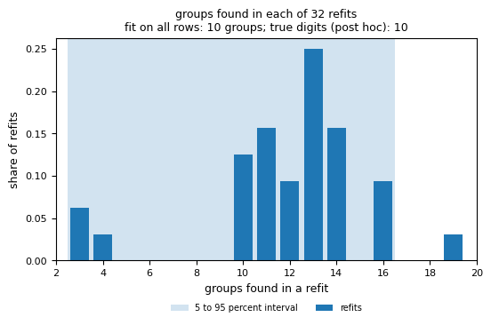
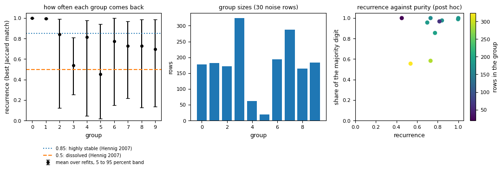

# Plot your result

This guide points at the plotting cells of the notebooks, names the attribute each plot reads, and shows how to read two of them. The notebooks hold the full code, so this page does not repeat it.

```{eval-rst}
.. index::
   single: plots
   single: notebook
   single: own support
   single: recurrence plot
   pair: plot; count of groups
```

## Prerequisites

- A result from `starfold.recover`, or one loaded with {doc}`save-and-load`.
- A clone of the repository, with `uv sync --extra bench`, so that you can open `notebooks/01_digits.py` (a jupytext file that Jupyter opens as a notebook).
- `matplotlib`. Every plot below needs only that and the result. Plots marked post hoc also need known labels ({doc}`check-against-known-labels`).

## Steps

1. Open `notebooks/01_digits.py`. Its first cell finds the repository root and its parameters cell sets `RANDOM_STATE`, `ENGINE`, `N_JOBS` and `FIGURES`. Set `FIGURES` to a folder to save each figure as it is drawn.

2. Replace the data cell and the `recover` cell with your own table and result. Every plotting cell after them reads only from `result`.

3. Run the plotting cells in the order below. Each row names the heading of the cell in `notebooks/01_digits.py` and what it reads.

   | Heading of the cell | Reads | Shows |
   |---|---|---|
   | A picture of the groups | `result.labels`, `result.worlds.own_support`, `result.default_labels` | the rows on a 2-D map, in three panels: known classes (post hoc), Starfold, library defaults |
   | Settings against groups | `result.search.trials`, each trial's `score`, `fit_counts` and `phase` | the score of every complete trial against the groups it found |
   | Support per row | `result.worlds.own_support`, `result.worlds.unresolved` | how reliably each grouped row comes back |
   | Recurrence per group | `result.worlds.group_recurrence` and `group_recurrence_band` | how often each group comes back, and the group sizes |
   | How many groups | `result.worlds.count_values` and `count_interval` | the groups found in each refit |
   | The co-association check | `result.consensus` | within-group, between-group and contrast values |

   The notebook draws the map in 2-D by fitting UMAP again with the chosen `n_neighbors` and `min_dist`. If the chosen map has more than two coordinates, the picture is a separate 2-D display map and not the space in which the groups were found.

4. Save the figures as PDF if they are for a paper. The notebook writes PNG at 150 dpi for the manual. Change the extension and the `savefig` call in `save_figure`.

5. For the structureless copies and the calibration histograms, use `notebooks/03_calibration.py` (`starfold.generate_null(x, family, seed=0)` makes a copy). For physical units of the groups, use the cell "The groups in physical units" in `notebooks/02_apogee.py`, which reads `result.worlds.property_median` and `property_band`.

## Reading two plots

### Groups found in each refit



The bars show how many refits found each group count. Most of the mass lies between 10 and 14 groups, and a few refits found 3, 4 or 19. The shaded band is the stability interval, 3 to 16. The fit on all rows has 10 groups, and only about one refit in eight (4 of 32) found exactly 10. The decision this supports: quote the interval and not the single count. This run raises `count_unstable`, which means fewer than half the refits found the same count as the fit on all rows. The count is not an estimate of how many populations exist ({term}`count interval`).

### Recurrence of each group



The left panel shows one dot per group, with a band over refits. Groups 0 and 1 sit at 1.00 with no visible band, so they come back in almost every refit. Group 5, the smallest (19 rows), has the lowest value, 0.45 (band 0.02 to 0.94), and group 3 has 0.54 (0.25 to 0.81). The other six lie between 0.70 and 0.84, with wide bands whose lower ends run from 0.05 to 0.22. The dotted line at 0.85 and the dashed line at 0.5 are the `clusterboot` marks (R package fpc) for a highly stable mean and for a cluster that dissolved in one resample. Starfold quotes them and never uses them to drop a group. The decision this supports: describe groups 0 and 1 as reproducible and treat the wide-band groups as uncertain. Read the right panel (post hoc) before you say anything about what a group is. Recurrence is how often a group comes back across refits, not a probability. See {doc}`../metrics/recurrence`.

## Expected result

Five figures and one printed check for your result. Read each figure aloud and end on a decision, as in the two readings above. The Digits notebook reproduces the figures of this manual from the recorded run in `notebooks/runs/digits`.

## Variations

- **Replot without refitting.** Load the saved result with `starfold.load("notebooks/runs/digits")` and run only the plotting cells. The recorded run is in the repository.
- **Your own figure.** Every array the notebooks plot is an attribute listed in {doc}`../reference/artifacts`.

## Related pages

- {doc}`../tutorial/index`
- {doc}`../metrics/support`
- {doc}`../metrics/count-interval`
- {doc}`save-and-load`
