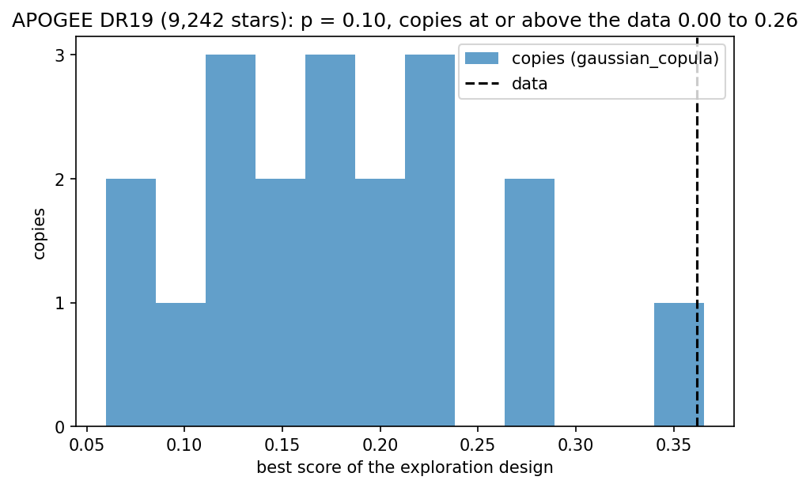
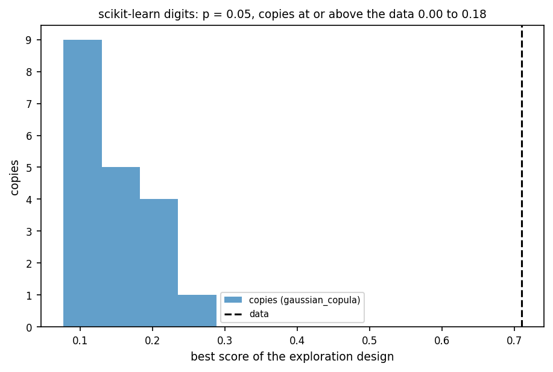

# Calibration p-value

This page explains the calibration p-value, an add-one estimate of the share of structureless copies of your table that reach at least as high a gap as the table.

```{eval-rst}
.. index::
   single: p-value
```
```{eval-rst}
.. index::
   single: calibration test
```
```{eval-rst}
.. index::
   single: structure_supported
```
```{eval-rst}
.. index::
   single: null_not_run
```
```{eval-rst}
.. index::
   single: Monte Carlo interval
```
```{eval-rst}
.. index::
   single: structureless copy
```
```{eval-rst}
.. index::
   pair: metric; p-value
```

## The question it answers

Would the same search, run on a copy of your table that has no groups, score as high as it does on your table?

A {term}`structureless copy` keeps every value of every column and changes only which row each value sits in. By default the test replays trials 0 to 16 of the search on your table and on up to 19 copies. These are trial 0 (the library defaults) and the 16-trial {term}`Sobol design`, a set of settings spread evenly over the allowed ranges. Its statistic is the largest search {term}`gap` among those 17 trials, where the gap is the score on the data minus the score on a structureless copy. It is not the best score of the full search. The {term}`p-value` counts the copies that reach the table's value. The option `null_procedure="full_search"` replays the whole search instead.

## A picture

Each bar below counts copies by their best gap among the 17 opening trials. The dashed line is the table's best gap.



The figure's own caption calls this value the best exploration score. It is the best gap among trials 0 to 16. Look at the copies between 0.06 and 0.29, and at the single copy at the far right, inside the last bar next to the dashed line. One copy reached as high as the table, so the evidence for APOGEE is weak.

For Digits, the dashed line sits right of every bar.



Look at the empty space between the last bar and the dashed line. No copy reached the table, so p is at its floor. The table's value, 0.710, is the search gap of trial 7.

## Range and reference values

- Range: p = (h+1)/(L+1) (Phipson and Smyth 2010), with h the copies at or above the table (an exceedance is one such copy) and L the copies drawn. It runs from 1/(L+1) to 1. With 19 copies the smallest value is 1/20 = 0.05. The p-value can never be 0.
- Perfect result: the floor, 0.05 at 19 copies, meaning no copy reached the table. It does not say by how much the table won.
- Pure chance: if the table is a draw from the declared family, the p-value is valid. The chance that p is at most alpha is at most alpha (Besag and Clifford 1991, doi:10.1093/biomet/78.2.301). It is not spread evenly, because the test stops at 3 exceedances. A value near 1 often comes from an early stop, when the first copies all reach the table.

| Copies L | p for h = 0 | h = 1 | h = 2 | h = 3 |
|---|---|---|---|---|
| 4 | 0.200 | 0.400 | 0.600 | 0.800 |
| 9 | 0.100 | 0.200 | 0.300 | 0.400 |
| 19 | 0.050 | 0.100 | 0.150 | 0.200 |
| 99 | 0.010 | 0.020 | 0.030 | 0.040 |

The table is the recorded output of `notebooks/03_calibration.py`. A lower floor needs more copies (99 copies reach 0.01 at up to 10,098 fits).

## How to read a value

The level {term}`alpha` is 0.05 by default. `structure_supported` is true when the p-value is at most alpha. The readings below hold at the default 19 copies only. With 99 copies, for example, the floor is 0.01. Three exceedances stop the test and give p = 4/(L+1), with L the copies used by then. So a p at or below 0.05 no longer means that no copy reached the table.

| p-value (19 copies) | Reading | Decision |
|---|---|---|
| At most 0.05 | No copy of the declared family scored as high as the table | Say that the table beats the declared family, and name the family |
| Above 0.05 | At least one copy scored as high | Report the groups as reproducible, not as shown to exceed the copy |
| 1.0 with `null_not_run` | The test did not run | There is no result. Run `starfold.null_test` |

The bands follow the notebooks. Neither reading says anything about how many groups exist or whether any one group is real.

## What misleads

- A small p-value is not the probability that the groups are real. It is valid only for the declared family of copies and for the procedure that was simulated. The default family, `gaussian_copula`, keeps every column's values exactly. It couples the columns through a fitted, shrunk Gaussian dependence on normal scores, so it does not reproduce the observed correlations exactly. It keeps any multimodality of a single column, and removes only multimodality that needs several columns together.
- A large p-value is not a finding of no groups. In the APOGEE record, one copy reached a best gap of 0.366 against the table's 0.362. The interval on the share of copies is wide (0.001 to 0.260) because 19 copies are few.
- The test stops after 3 copies reach the table's value (Besag and Clifford 1991, a rule that ends the simulation once the answer is clear). At the default 19 copies, p after that stop is at least 4/(L+1), so it is at least 0.2 and cannot reach 0.05. More copies would only refine a value above alpha. With more than 19 copies allowed, this statement no longer holds.
- The placeholder 1.0 is not a measurement. When no family was declared, `skipped_reason` is `null_not_run`, `p_value` is 1.0 and `structure_supported` is false. When the table's own statistic is zero or below, `skipped_reason` is `observed_statistic_zero`.

The interval is a 95 percent Clopper-Pearson interval (an exact binomial interval) on h/L, the share of copies at or above the table. It is the range of shares that could plausibly have produced h exceedances in L copies. It measures Monte Carlo precision only, is not an interval on the p-value, and says nothing about the table beyond the copies drawn. Starfold's own name for it is the {term}`Monte Carlo interval`.

## Where Starfold prints it

The attributes are `result.null.p_value`, `result.null.p_intervals`, `result.null.structure_supported` and `result.null.skipped_reason`. With several families, `p_value` is the largest of the families' p-values. The call is below. The configuration, seed and engine must equal those of the run, so pass them from the saved provenance.

```python
evidence = starfold.null_test(
    X[result.kept_rows],
    result.search,
    config=config,
    random_state=result.provenance["random_state"],
    engine=result.provenance["engine_resolved"],
)
```

Here `config` is the `Config` the run used. From the command line, `python -m bench.null_stage <dataset> <result folder> --output <folder>` replays the saved run's settings and writes `<dataset>_null.json` into the folder you name. Without `--output` it writes to `bench/results`, where it would overwrite the recorded file. The notebook `notebooks/03_calibration.py` read the recorded test records in `bench/results/` and printed the lines below.

```python
for name, record in records.items():
    low, high = record["p_intervals"][0]
    print(
        f"{name:7s} observed {record['observed']:.3f}, {record['n_realisations'][0]} copies, "
        f"{record['exceedances'][0]} at or above the data, p {record['p_value']:.2f}, "
        f"fraction at or above {low:.3f} to {high:.3f} (95% Monte Carlo interval), "
        f"{record['n_fits']} fits, supported {record['structure_supported']}"
    )
```

You see (records `bench/results/digits_null.json` and `apogee_null.json`):

```text
digits  observed 0.710, 19 copies, 0 at or above the data, p 0.05, fraction at or above 0.000 to 0.176 (95% Monte Carlo interval), 1938 fits, supported True
apogee  observed 0.362, 19 copies, 1 at or above the data, p 0.10, fraction at or above 0.001 to 0.260 (95% Monte Carlo interval), 1938 fits, supported False
```

The recorded runs in `notebooks/01_digits.py` and `notebooks/02_apogee.py` had the test off. Their `result.null.skipped_reason` is `null_not_run` and the placeholder 1.0 is in `result.null.p_value`.

:::{dropdown} Formula
With $L$ copies drawn and $h$ of them at or above the observed statistic (a tie counts against the table),

$$
p = \frac{h + 1}{L + 1}.
$$

The table counts as one more draw (Phipson and Smyth 2010), so $p \ge 1/(L+1)$. The sequential rule stops a family after $h = 3$ exceedances or $L = 19$ copies, whichever comes first (Besag and Clifford 1991). The interval is the two-sided 95 percent Clopper-Pearson interval on $h/L$:

$$
\left(B^{-1}(0.025;\ h,\ L-h+1),\ B^{-1}(0.975;\ h+1,\ L-h)\right),
$$

where $B^{-1}(q; a, b)$ is the $q$ quantile of the Beta distribution. It is $0$ at the lower end when $h = 0$ and $1$ at the upper end when $h = L$. Across families, $p$ is the maximum, and `structure_supported` is $p \le \alpha$.
:::

## Learn more

- Add-one Monte Carlo p-value: Phipson and Smyth (2010), [doi:10.2202/1544-6115.1585](https://doi.org/10.2202/1544-6115.1585).
- Sequential stopping: Besag and Clifford (1991), [doi:10.1093/biomet/78.2.301](https://doi.org/10.1093/biomet/78.2.301). Exact binomial interval: Clopper and Pearson (1934), [doi:10.1093/biomet/26.4.404](https://doi.org/10.1093/biomet/26.4.404).
- Glossary: {term}`p-value`, {term}`structureless copy`, {term}`alpha`, {term}`null hypothesis`. Related pages: {doc}`recurrence`, {doc}`coassociation`.
