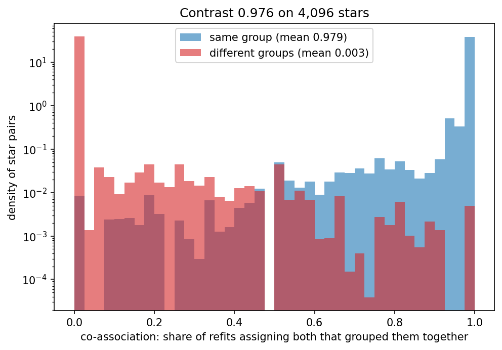

# Co-association, contrast and the consensus check

This page explains co-association and contrast, the label-free check of whether refits agree on which rows belong together, and the cut that the consensus check adds.

```{eval-rst}
.. index::
   single: co-association
```
```{eval-rst}
.. index::
   single: contrast
```
```{eval-rst}
.. index::
   single: consensus check
```
```{eval-rst}
.. index::
   single: consensus_disagrees
```
```{eval-rst}
.. index::
   single: consensus_subsampled
```
```{eval-rst}
.. index::
   pair: metric; contrast
```
```{eval-rst}
.. index::
   pair: metric; consensus agreement
```

## The question it answers

Do the refits put the same pairs of rows together that your partition puts together, whatever numbers they give to their groups?

Group numbers are arbitrary. One refit's group 0 can be another's group 1. {term}`Co-association` of a pair of rows avoids the problem. It is the share of refits that put both rows in the same group, among the refits that drew and assigned both.

- Within: the mean co-association over pairs of rows in the same group of your partition.
- Between: the mean over pairs in different groups.
- {term}`Contrast`: within minus between.

The {term}`consensus check` adds one more step. It turns the co-association into a distance (1 minus the share), runs {term}`HDBSCAN` on that distance, and compares the resulting groups with your partition. The comparison is the consensus agreement: the {term}`adjusted Rand index` (floored at 0) times the {term}`coverage` of rows that both partitions assign. This page says "consensus agreement" for it, because Starfold uses the word agreement for four different numbers (see the {doc}`../glossary`).

## A picture

Take four rows, a and b in group 0, c and d in group 1, and four refits (toy numbers).

```text
refit 1: {a b} {c d}
refit 2: {a b} {c d}
refit 3: {a b c} {d}
refit 4: {a b} {c d}
pair a-b : together in 4 of 4 refits -> 1.00   (same group in the partition)
pair c-d : together in 3 of 4 refits -> 0.75   (same group in the partition)
pair a-c and b-c : together in 1 of 4 refits -> 0.25 each (different groups)
pair a-d and b-d : together in 0 of 4 refits -> 0.00 each (different groups)
```

Within is (1.00 + 0.75) / 2 = 0.875. Between is (0.25 + 0.25 + 0 + 0) / 4 = 0.125. The contrast is 0.875 minus 0.125, which is 0.75.

The recorded APOGEE histogram below shows the same idea on 4,096 stars. Blue is pairs in the same group and red is pairs in different groups.



Look at the two spikes. Blue pairs pile up at 1, so refits almost always put them together. Red pairs pile up at 0, so refits almost never do. A low contrast would show both colours overlapping in the middle.

## Range and reference values

- Within and between: 0 to 1. With 32 refits the largest value is 1 minus 1/64, because the distance is floored at 1/(2W) to keep perfectly recurrent pairs at a finite distance.
- Contrast: minus 1 to 1 in principle. Perfect result: near 1. Pure chance: not applicable as a fixed value. Contrast near 0 means refits treat within-group and between-group pairs alike.
- Consensus agreement: 0 to 1. Perfect result: 1, the cut reproduces your partition. For chance, the adjusted Rand index is about 0, so the consensus agreement is about 0.
- A pair that no refit assigned together has no evidence of association and counts as co-association 0.

## How to read a value

Read the contrast first. It needs no cut. The 0.5 threshold on consensus agreement is the code's `consensus_disagrees` rule. The contrast bands are `[no-source: internal-reasoning]`.

| Reading | Values | Decision |
|---|---|---|
| Refits agree with your partition | Contrast above about 0.7 | Trust the partition as reproducible under resampling, not as true |
| Partial match | Contrast from about 0.3 to 0.7 | Look at which groups have low support ({doc}`support`) |
| Refits disagree | Contrast below about 0.3 | Do not treat the partition as reproducible |

A consensus agreement below 0.5 raises the {term}`flag` `consensus_disagrees`. It means the second check, the cut, gave a different grouping from yours. It is not an error. Read it together with the contrast. If the contrast is high and the consensus agreement is low, suspect the cut first.

## What misleads

- Consensus agreement 0.0 with contrast 0.976 is a cut failure, not evidence of absent groups. In the recorded APOGEE run the cut labelled all 4,096 subset stars as noise, while within was 0.979 and between 0.003. The contrast, which needs no cut, shows the refits agree.
- The cut is a second clustering. It can fail where the pair shares still separate the groups. The cause of the all-noise cut on APOGEE was not diagnosed. The code notes that rows at the floor distance can let single linkage merge neighbouring groups.
- Above 5,792 rows the check uses a subset of 4,096 rows (flag `consensus_subsampled`). Contrast then describes the subset only.
- High contrast does not make the groups true. It measures how well refits agree with one fit.

## Where Starfold prints it

The attribute is `result.consensus`, with `within_association`, `between_association`, `contrast`, `agreement`, `subsampled`, `n_rows` and `bytes_used`. The peak memory is 16 bytes per pair of rows (the float64 matrix plus HDBSCAN's copy). The default budget is 512 MiB (`Config.consensus_budget_bytes`), which allows 5,792 rows. Above that, Starfold draws a seeded subset of `Config.consensus_check_rows` = 4,096 rows, which uses 256 MiB. The check refuses a subset that would exceed the budget.

The notebook `notebooks/01_digits.py` printed the recorded lines below. These lines run inside the notebook, where `result` and `np` are already defined.

```python
c = result.consensus
print(f"rows used: {c.n_rows} (subset: {c.subsampled}), memory: {c.bytes_used / 2**20:.0f} MiB")
print(f"within-group co-association:  {c.within_association:.3f}")
print(f"between-group co-association: {c.between_association:.3f}")
print(f"contrast:                     {c.contrast:.3f}")
print(f"agreement of the cut with labels (ARI times coverage): {c.agreement:.3f}")
print(f"groups in the cut: {np.unique(c.labels[c.labels >= 0]).size}")
```

You see (recorded Digits run, 32 refits):

```text
rows used: 1797 (subset: False), memory: 49 MiB
within-group co-association:  0.820
between-group co-association: 0.068
contrast:                     0.751
agreement of the cut with labels (ARI times coverage): 0.135
groups in the cut: 3
```

Digits also has a high contrast (0.751, in the top band) and a low consensus agreement (0.135), so `consensus_disagrees` was raised there too. Its cut returned 3 groups, not noise, so the failure mode differs from APOGEE. The recorded APOGEE run (`notebooks/02_apogee.py`) printed `4,096 stars (seeded subset): within 0.979, between 0.003, contrast 0.976, cut agreement 0.000`.

:::{dropdown} Formula
For rows $i$ and $j$, $N_{ij}$ counts the refits that drew and assigned both, and $C_{ij}$ those that also gave them the same group. With $W$ refits,

$$
D_{ij} = \max\!\left(1 - \frac{C_{ij}}{N_{ij}},\ \frac{1}{2W}\right),\quad D_{ij}=1 \text{ if } N_{ij}=0,\quad D_{ii}=0 .
$$

Within is the mean of $1 - D_{ij}$ over distinct pairs that your partition assigns to the same group. Between is the mean over pairs assigned to different groups. Contrast is within minus between. Pairs with a noise row are excluded. The cut is scikit-learn HDBSCAN on $D$ with `metric="precomputed"` and your setting's `selection_method`. Its `min_cluster_size` and `min_samples` both equal the `min_cluster_size` of your setting (rescaled to the subset size when a subset is used). Consensus agreement is $\max(0, \mathrm{ARI}) \times$ joint coverage against your partition.

The dense check needs $16 n^2 \le 536{,}870{,}912$ bytes (512 MiB), so $n \le 5{,}792$.
:::

## Learn more

- Evidence accumulation: Fred and Jain (2005), [doi:10.1109/TPAMI.2005.113](https://doi.org/10.1109/TPAMI.2005.113).
- Consensus clustering: Monti et al. (2003), [doi:10.1023/A:1023949509487](https://doi.org/10.1023/A:1023949509487).
- Adjusted Rand index: Hubert and Arabie (1985), [doi:10.1007/BF01908075](https://doi.org/10.1007/BF01908075), and the scikit-learn [clustering performance evaluation](https://scikit-learn.org/stable/modules/clustering.html).
- Glossary: {term}`Co-association`, {term}`Contrast`, {term}`consensus check`. Related pages: {doc}`recurrence`, {doc}`support`.
