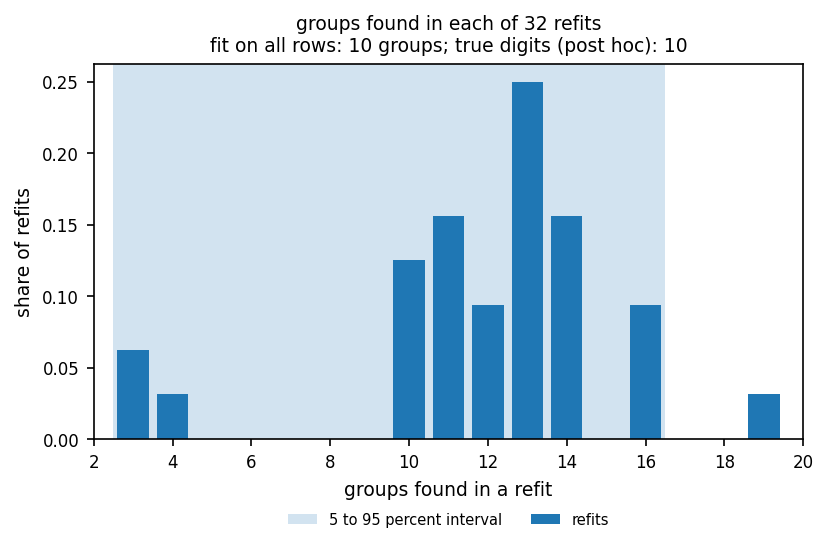

# Count interval

This page explains the count interval, the range of group counts that the refits found.

```{eval-rst}
.. index::
   single: count interval
```
```{eval-rst}
.. index::
   single: count_interval
```
```{eval-rst}
.. index::
   single: count_unstable
```
```{eval-rst}
.. index::
   single: stability interval
```
```{eval-rst}
.. index::
   pair: metric; count interval
```

## The question it answers

When you fit again on random subsets, how many groups do the refits find?

The {term}`count interval` is the 5th to 95th percentile of the refit group counts, rounded outward to whole numbers. It is a {term}`stability interval`, the range over {term}`refit` runs. It is not a {term}`confidence interval`, and it is never a finding about how many populations exist.

## A picture

Take 32 refits (toy numbers). Thirty find 2 groups, one finds 3 and one finds 1.

```text
groups found :  1    2    3
refits       :  1   30    1
```

The 5th percentile of the 32 counts is 2 and the 95th is 2. The interval is 2 to 2. Almost every refit found the same count, so the count reproduces.

Now take a table where refits find between 3 and 19 groups. The interval is wide, so the count does not reproduce. The recorded run on the scikit-learn digits dataset is such a case. The recorded runs quoted on this page ship in the repository under `notebooks/runs/digits` and `notebooks/runs/apogee`. Notebooks 01 and 02 write them, and `starfold.load` reads them.



Look at the shaded band and the bars. Refits found 3 to 19 groups, and the interval runs from 3 to 16. The full fit has 10 groups. The bar at 13 is tallest, so the full fit's count is not the most common refit count.

## Range and reference values

- Range: two integers, low and high, with low at most high. Both are at least 0.
- Perfect result: a width of 0, such as 2 to 2, that contains the full fit's group count.
- Pure chance: not applicable.

## How to read a value

The code raises `count_unstable` when fewer than half of the refits find the same count as the full fit. The width bands below are a rule of thumb from this project, not from a published source.

| Interval | Reading | Decision |
|---|---|---|
| Width 0 and contains the full fit's count | The count reproduces | Report the count as reproducible under resampling |
| Narrow and contains the count | The count mostly reproduces | Report the interval, not one number |
| Wide, or does not contain the count | The table supports several readings | Report the interval, and do not quote one count (flag `count_unstable` may be raised) |

## What misleads

- A narrow interval does not make the count correct. It says the count is stable under resampling.
- The number of arbitrary, overlapping populations is not identifiable without a declared estimand and assumptions. A stability interval over refits cannot supply one.
- The interval comes from settings chosen for one table. A different setting can give a different count with the same narrow width.
- Do not tune or judge a run on the group count. Starfold's score never reads it.

## Where Starfold prints it

The attributes are `result.worlds.count_interval` (a pair of integers), `result.worlds.count_values` (the count found by each refit) and `result.worlds.count_reference` (the full fit's count). The notebook `notebooks/02_apogee.ipynb` printed the recorded lines below. These lines run inside the notebook, where `worlds` and `np` are already defined.

```python
counts, frequency = np.unique(worlds.count_values, return_counts=True)
print(
    "groups per refit:",
    ", ".join(f"{c} in {f} refits" for c, f in zip(counts, frequency, strict=True)),
)
print(f"interval {worlds.count_interval[0]} to {worlds.count_interval[1]}")
```

For the APOGEE DR19 example table, with 32 refits, it printed:

```text
groups per refit: 2 in 31 refits, 3 in 1 refits
interval 2 to 2
```

The recorded digits run (`notebooks/01_digits.ipynb`) printed `refits: 32; groups found: 3 to 16` for the same attribute.

:::{dropdown} Formula
Let $c_w$ be the number of refit groups in refit $w$. Let $q_5$ and $q_{95}$ be the 5th and 95th percentile of the $c_w$ with linear interpolation. Then

$$
\text{count interval} = \left(\lfloor q_5 \rfloor,\ \lceil q_{95} \rceil\right).
$$

The flag `count_unstable` is raised when the share of refits with $c_w$ equal to the full fit's count is below 0.5.
:::

## Learn more

- Cluster-wise stability under resampling, the approach behind the refits: Hennig (2007), [doi:10.1016/j.csda.2006.11.025](https://doi.org/10.1016/j.csda.2006.11.025). The paper assesses single clusters. It does not choose a group count, and this page cites no source for choosing one.
- Why HDBSCAN returns different counts at different settings: [parameter selection in hdbscan](https://hdbscan.readthedocs.io/en/latest/parameter_selection.html).
- Glossary: {term}`Count interval`, {term}`stability interval`, {term}`confidence interval`. Related pages: {doc}`recurrence`, {doc}`unresolved`.
