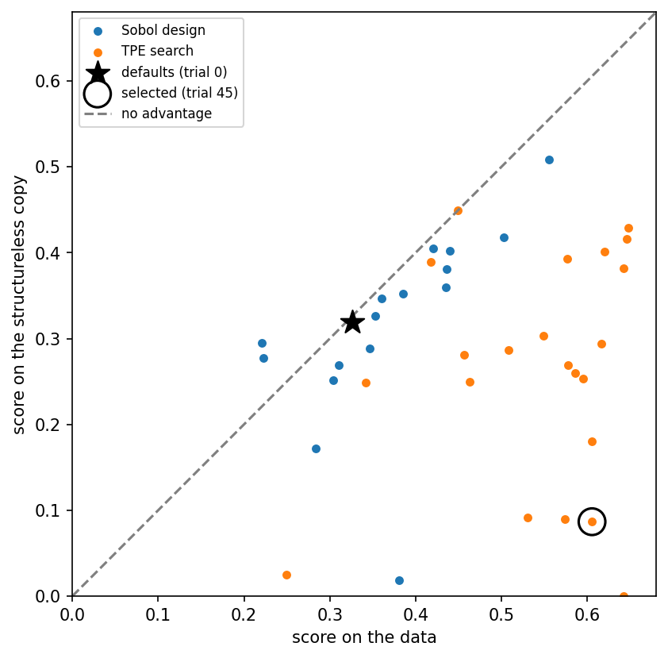

# Gap

This page explains the gap, the number Starfold uses to rank {term}`setting`s, and shows how to read it.

```{eval-rst}
.. index::
   single: gap
   pair: metric; gap
   single: structureless copy
   single: winner's curse
   single: fresh re-score
   single: default_within_noise
   single: gap statistic
```

## The question it answers

How much better does a setting score on your table than on a {term}`structureless copy` of it? For why Starfold compares with a copy at all, see {doc}`../concepts/copies-and-gaps`.

## A picture

A structureless copy keeps every value of every column, exactly as measured, so each column keeps its own distribution. It reorders which values sit together, and couples the columns through one fitted, shrunk Gaussian dependence on normal scores. Its rank correlations come close to the table's but do not match exactly. The copy has no groups that need several columns together, but a single column with several peaks keeps them. Starfold scores each setting on the table and on the copy, on the same subsets, and takes the difference: the {term}`gap`.

The figure below shows every complete trial of the recorded run on the APOGEE DR19 example table. The score on the data is on the horizontal axis and the score on the copy on the vertical axis. The recorded runs quoted on this page ship in the repository under `notebooks/runs/digits` and `notebooks/runs/apogee`. Notebooks 01 and 02 write them, and `starfold.load` reads them.



The dashed diagonal marks a gap of zero. The black star is the library defaults, which sit next to the diagonal: they score about the same on the data and on the copy. The circled point is the selected trial, far below the diagonal. Its gap is large, because it scores much higher on the data than on the copy. A setting well below the diagonal found something in your table that the copy does not have. A setting on the diagonal gained nothing from your data.

High picture: a setting that scores 0.6 on the data and 0.1 on the copy has a gap of 0.5. Low picture: a setting that scores 0.33 on both has a gap near 0, however tidy its groups look.

## Range and reference values

| Quantity | Value |
|---|---|
| Range | -1 to 1 in principle; recorded fresh gaps run from -0.001 (APOGEE DR19 defaults) to 0.661 (digits, chosen) |
| Perfect result | 1 (score 1 on the data, 0 on the copy; not reached in practice) |
| Pure chance | about 0 (a setting that does no better on the data than on a copy) |

The gap can be negative when a setting scores higher on the copy than on the data. The word "gap" in this manual always means this difference of scores, never a blank space in a figure.

## How to read a value

The bands are a rule of thumb from this project, not from a published source. They describe the fresh gap. The gap depends on the table, and only differences between settings on the same table have a fixed meaning.

To judge whether this setting finds anything in your table that a structureless copy lacks, read the fresh gap, not the search gap.

| Value | Reading | Decision |
|---|---|---|
| Below 0.1 | About as good on a copy | The copy comparison gives no support for structure in your table; this does not show there is none |
| 0.1 to 0.4 | Some advantage over the copy | Run the calibration test and read {doc}`recurrence` for each group |
| Above 0.4 | Large advantage over the copy | Still check recurrence: a large gap is not a true partition |

## What misleads

1. The winner's curse. The best score of many noisy trials is partly luck, so it is too high. In the recorded digits run, trial 37 had a search gap of 0.797, the highest of the search. On fresh subsets and fresh copies, its gap was 0.414. Starfold therefore re-scores the top three complete trials and the defaults on new subsets and new copies and picks the largest fresh gap. The re-score reduces this optimism, because the fresh subsets and copies are independent of the ones that ranked the trials. It does not remove it: the winner is still the largest of up to four noisy fresh gaps, so its fresh gap keeps some upward bias.
2. The copy is one declared family. A gap over a Gaussian copula says the table beats copies with the same column distributions and the same rank correlations but one Gaussian dependence structure. It does not say the table beats every structureless alternative.
3. The search gap uses one fixed copy and three subsets. The fresh gap uses three fresh copies, so it is steadier, but it still varies with the seed.
4. The gap is label-free. In the recorded digits run, the Spearman correlation between the trial gap and the agreement with the true digits was 0.159 over 34 complete trials. A larger gap does not promise a better recovery of any labels you hold.

## The flag default_within_noise

The {term}`flag` `default_within_noise` is raised when the chosen setting is not the defaults and the two fresh scores are close. Close means they differ by no more than twice the standard error of their six paired differences. Each pair of subsets gives one difference, so the test uses the 6 differences that `result.search.paired_differences` holds. The flag compares fresh scores, not fresh gaps. If it is raised, the choice between the defaults and the chosen setting is not resolved by the data.

In the recorded digits run, the six differences were 0.087, 0.032, 0.075, 0.004, 0.045 and -0.016. Their standard deviation is about 0.040, so twice the standard error is about 0.033. The fresh scores differ by 0.039 (0.828 against 0.789), which is larger, so the flag was not raised.

Read the flag as an approximate screen, not a test. The noise estimate is optimistic. The six differences come from only three subsets, and the pairs (r, s) and (s, r) share both subsets, so they are not six independent draws. The standard error is therefore too small, and the flag is raised less often than an honest test would raise it. A run without the flag can still have a chosen setting that is not better than the defaults. The flag compares fresh scores while the choice uses fresh gaps, so the two can point in different directions.

## Where Starfold prints it

| Where | What it holds |
|---|---|
| `result.search.trials[i].score` | search gap of trial `i` (`raw_score - null_score`) |
| `result.search.candidates[i].gap` | fresh gap of a re-scored candidate |
| `result.search.gap_selected`, `result.search.gap_default` | fresh gaps of the chosen setting and the defaults |

The notebook for the APOGEE DR19 example table prints the fresh gaps under the figure above:

```python
print(
    f"fresh gap over three fresh copies: selected {search.gap_selected:.3f}, "
    f"defaults {search.gap_default:.3f}"
)
```

The recorded output, from `notebooks/02_apogee.ipynb` with `RANDOM_STATE = 0`, is:

```text
fresh gap over three fresh copies: selected 0.372, defaults -0.001
```

The digits notebook prints a table of the candidates with the search gap and the fresh gap side by side. Trial 33 went from 0.730 to 0.661, trial 7 from 0.710 to 0.455 and trial 37 from 0.797 to 0.414. The calibration test also uses the search gap. Its statistic is the largest search gap among trials 0 to 16. For the digits run that is 0.710, the gap of trial 7 (see {doc}`calibration-p`).

:::{dropdown} Formula
With `S(theta; X)` the {doc}`score` of setting `theta` on the table `X`, and `X_copy` the structureless copy (by default a Gaussian copula, or `independent_marginals`),

```text
search gap     = S(theta; X) - S(theta; X_copy)              one fixed copy, the search's plan
fresh gap      = S(theta; X) - mean over 3 fresh copies of S(theta; X_copy)   fresh plan
```

The fresh plan has new subsets and three new copies. The largest fresh gap among the top 3 complete trials and trial 0 is selected, with ties going to the lowest trial number. The defaults win only a tie they are part of. The gap family is set in `Config` by `gap_family` (`None` turns the gap off, and then the gap equals the score). The source is `search` and `_Run.rescore` in `src/starfold/search.py`, and `derive_flags` in `src/starfold/result.py`.
:::

## Learn more

- Tibshirani, Walther and Hastie 2001, the gap statistic: [doi:10.1111/1467-9868.00293](https://doi.org/10.1111/1467-9868.00293).
- Glasserman and Yao 1992, why every trial uses the same subsets: [doi:10.1287/mnsc.38.6.884](https://doi.org/10.1287/mnsc.38.6.884).
- Next: {doc}`default-comparison`, and the calibration test in {doc}`calibration-p`.
