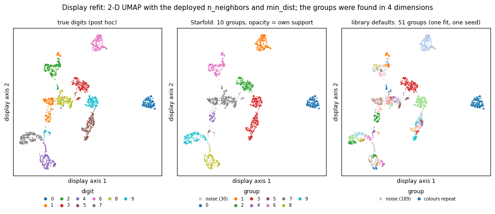

# Your first run

This page runs Starfold on a table of 1,797 handwritten digit images in five lines and shows you how to read the result.

```{eval-rst}
.. index::
   single: first run
   single: flag
   single: group
   single: noise
   single: digits
   pair: example; handwritten digits
```

Install first, in one line: `pip install "starfold @ git+https://github.com/AndreasWNeitzel/starfold"`. The {doc}`install` page has the virtual environment and the GPU options.

## What you need

- Starfold installed, Python 3.11 or 3.12.
- scikit-learn, which Starfold already installs. It ships the digits table, so you download nothing.
- A few minutes. The recorded run took 80.4 s on a laptop RTX 3060 with {term}`cuML` when the run had the GPU to itself. The recorded output shows 182.0 s because notebook 02 ran at the same time. A CPU run is not measured here; expect it to take longer.

## What the call does

`starfold.recover` runs the whole procedure in one call. It searches the settings of {term}`UMAP` and {term}`HDBSCAN` with {term}`Optuna` and fits the winning {term}`setting` on all rows. Then it refits that setting on 32 random subsets of 80 percent of the rows. Each of those fits is a {term}`refit`. The refits show how much the groups change when the rows change. `random_state=0` is the {term}`seed` from which every random choice derives.

The last line of the code prints four things, in this order:

1. The {term}`flag`s: short names for weak evidence or notable events.
2. The number of groups in the fit on all rows.
3. The {term}`count interval`: the range of group counts that the 32 refits found.
4. The {term}`unresolved mass`: how often a row failed to stay with its group across refits.

The page explains each one after the output.

## Steps

1. Put these five lines in a file or a notebook cell.

   ```python
   import starfold
   from sklearn.datasets import load_digits
   X = load_digits().data
   result = starfold.recover(X, random_state=0)
   print(result.flags, result.n_groups, result.worlds.count_interval, f"{result.unresolved_mass:.3f}")
   ```

2. Run them. Nothing prints until the fit ends.

   You see:

   ```text
   ('search_budget_exhausted', 'count_unstable', 'consensus_disagrees', 'null_not_run') 10 (3, 16) 0.044
   ```

   The numbers come from the recorded run (`notebooks/runs/shots/01_digits.ipynb`, cuML engine, `random_state=0`). Another engine, machine or version can give other numbers, because the fits use random numbers and floating-point arithmetic. If yours differ a little, the reading below still holds. If the flags or the group count differ a lot, compare your versions and engine with the recorded ones: {doc}`../howto/reproduce-a-run`.

## What each code line does

1. `import starfold` loads the package. It does not load UMAP until needed.
2. `load_digits` is scikit-learn's table of 8 by 8 pixel images of handwritten digits.
3. `.data` keeps the 1,797 {term}`row`s and 64 {term}`column`s of pixel values (0 to 16). The true digit of each image, in `.target`, is not loaded. Starfold never sees it.
4. `starfold.recover` does everything described above.
5. `print` shows the four things listed above.

## Read the printout

Read the flags first, then the group count, then the interval, then the unresolved mass.

**The flags.** Four are raised:

- `search_budget_exhausted` says the search used all 48 trials. It only says how the search ended.
- `count_unstable` says fewer than half of the refits found the same number of groups as the full fit. Do not quote a single group count.
- `consensus_disagrees` says a second check gave a different grouping. The check counts, for every pair of rows, how often the refits put them together (the {term}`co-association`), and cuts the rows into groups from those counts. The cut matched your labels with a score of 0.135 (the adjusted Rand index times coverage), below the 0.5 threshold, and it found 3 groups. Do not treat this as an error. Pairs of rows inside one group were together in 0.820 of the refits and pairs in different groups in 0.068. That gap, 0.751, is the {term}`contrast`, and it says the refits do separate your groups. The cut is the weak part of this check, not the groups. The {doc}`../concepts/refits` page explains co-association.
- `null_not_run` says the optional calibration test did not run, so there is no {term}`p-value`. It is expected, because the test is off by default.

**The groups.** `10` is the number of groups in the full fit. Thirty of the 1,797 rows are {term}`noise` (label -1): no clump claimed them. Noise is not a bad measurement.

**The interval.** `(3, 16)` is the 5th to 95th percentile of the number of groups the 32 refits found, rounded outward to whole numbers. It is a {term}`stability interval`, not a {term}`confidence interval`. A wide interval, as here, says the count changes with the rows drawn. Do not quote 10 as the number of digit classes on this evidence. The count is not a finding.

**The unresolved mass.** `0.044` is the average share of refit outcomes in which a row did not keep its full-fit group. A row counts as unresolved in one refit when that refit called it noise, or placed it with rows the full fit calls noise. Zero would mean every refit agrees with the full fit. Above 0.5 the flag `high_unresolved_mass` is raised: on average, most refit outcomes leave a row unresolved. At 0.044 it is low, so read the other numbers as usual.

**Which groups come back.** The printout does not show it, but the recorded run also gives each group a {term}`recurrence`. Two groups (0 and 1) come back with recurrence 1.00. The other eight come back only in part, between 0.45 and 0.84. Use the high-recurrence groups first. The {doc}`../tutorial/index` page reads every group.

## Look at the groups

The recorded notebook draws the groups on a two-dimensional picture, made by a separate UMAP fit for display. You do not need this figure to continue. It shows what Starfold found.



The left panel colours each image by its true digit, which Starfold never used. The middle panel colours the same images by Starfold's group. A faded point is a row with low own support: the refits rarely put that row back with its group. Own support runs from 0 to 1 and is not a probability or a purity. Grey points are the 30 noise rows. The right panel shows one fit of the library defaults on all rows (recorded run, `random_state=0`), which cuts the same map into 51 groups and 189 noise rows.

Compare the middle panel with the left panel, then with the right panel. The defaults split the map into many small pieces, while Starfold's ten groups follow the islands more closely. The decision: trust the solid-coloured groups first, and check the faded ones against their recurrence before you use them.

The display map is drawn by a separate UMAP fit. Distances between islands on it are not the ones HDBSCAN used, so do not read the gaps or sizes as measurements.

## What you learned

- One call gives labels, refit evidence and flags.
- Flags come first. Not every flag is a fault.
- A stable count is not a true count, and the interval here shows the count is not stable.
- Some groups recur fully (groups 0 and 1) and others only in part, so name the groups when you describe the result.

## Next steps

- Follow the full digits example, with every output explained: {doc}`../tutorial/index`.
- Understand what happened inside `recover`: {doc}`../concepts/index`.
- Look up a printed number: {doc}`../metrics/index`.
- Use your own table: {doc}`../howto/index`.
