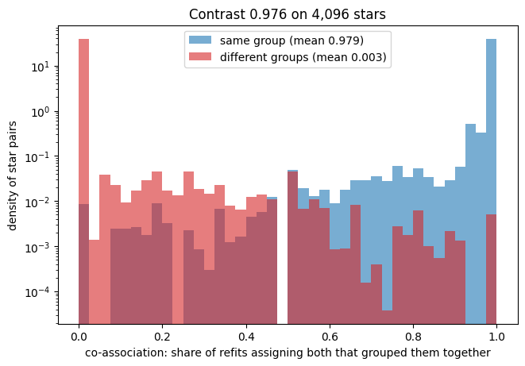
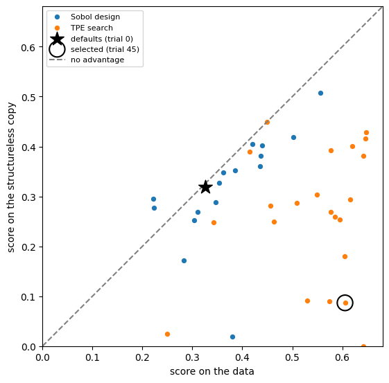

# Tutorial: two groups in 9,242 APOGEE stars, part 2

```{eval-rst}
.. index::
   single: tutorial; APOGEE, part 2
   single: co-association; cut failure
   single: calibration test; result
   single: how to report a run
   single: gap plot
```

This page checks the two APOGEE groups with the co-association check and the calibration test, then writes down what the run supports. It continues {doc}`apogee` and follows the second half of the notebook `notebooks/02_apogee.py`.

## Goal

You finish with two more pieces of evidence for how far to trust the two groups (co-association and a calibration test) and a paragraph you can put in a paper.

## Before you start

- Finish {doc}`apogee`. Keep the same Python session, because steps 8 to 10 use `result`, `x`, `names` and `starfold` from there.
- If you start a new session, load the recorded run from the clone instead. Run Python from the repository root:

  ```python
  import starfold
  from bench.datasets import example_table

  x, names = example_table()
  result = starfold.load("notebooks/runs/apogee")
  ```

- Step 10 runs a command that takes about 36 minutes on the recorded hardware, or you can read the recorded result without running it.
- The numbers below come from the recorded run with `random_state=0`. A different engine or machine can change the last digits.

## Step 8: run the co-association check

Group numbers are arbitrary: one refit's group 0 may be another's group 1. The check needs no matching, because it asks only whether two stars share a group. For a pair of stars, the {term}`co-association` is the share of refits that assigned both and put them in the same group. Pairs in the same group should sit near 1 and pairs in different groups near 0. The {term}`contrast` is the mean over same-group pairs minus the mean over different-group pairs.

```python
c = result.consensus
print(f"{c.n_rows:,} stars ({'seeded subset' if c.subsampled else 'all'}): "
      f"within {c.within_association:.3f}, between {c.between_association:.3f}, "
      f"contrast {c.contrast:.3f}, cut agreement {c.agreement:.3f}")
```

You see:

```text
4,096 stars (seeded subset): within 0.979, between 0.003, contrast 0.976, cut agreement 0.000
```



Read it aloud. The horizontal axis is the co-association of a pair, from 0 to 1. The vertical axis is the density of pairs on a logarithmic scale, so rare values show. The blue histogram (same group) has a tall spike at 1 and a mean of 0.979. The red histogram (different groups) has a tall spike at 0 and a mean of 0.003. Between 0.1 and 0.9 both histograms sit between about 0.0001 and 0.06, against about 40 at the spikes, so few pairs are undecided.

A good picture has the two spikes at opposite ends. A bad picture has both histograms centred in the middle, where refits disagree about which stars belong together.

**The recorded cut failure.** The check also regroups the stars: it runs {term}`HDBSCAN` on the co-association turned into a distance, and compares that cut with the partition. The consensus agreement (printed as "cut agreement": the cut against the partition, adjusted Rand index times coverage) is 0.000. The cut assigned every one of the 4,096 stars to no group. That is why `consensus_disagrees` is raised. The cause of the all-noise cut was not diagnosed. The code notes that rows at the floor distance can let the cut merge neighbouring groups.

What it does not mean: the groups are not absent. The contrast of 0.976 needs no cut, and it is high. What it does mean: the cut is a second clustering, and it can fail where the pair shares still separate the groups. So you must not cite it as independent confirmation of the partition here. In this run the evidence is the contrast, not the cut.

Decision: read the contrast first. A contrast near 1 says the refits agree with your partition. The {doc}`../metrics/coassociation` page has the bands.

## Step 9: compare the copy and the gap

Every trial was scored twice on the same subsets, once on the data and once on a {term}`structureless copy` of the table. The default copy is made with a {term}`Gaussian copula`: every column keeps exactly its measured values, and the columns are linked by a fitted, shrunk Gaussian dependence. The values are rearranged among the stars, so structure that needs several columns together is removed. A column with two peaks keeps both peaks. The search ranks settings by the {term}`gap`, the score on the data minus the score on the copy.



Read it aloud. Each dot is one finished trial. The horizontal axis is its score on the data. The vertical axis is its score on the copy. The dashed diagonal marks equal scores, "no advantage". Blue dots are the Sobol design and orange dots are {term}`TPE` proposals. The star is the library defaults (trial 0) and the ring is the selected trial, here trial 45.

A dot on the diagonal gains nothing from the data. A dot far below it scores well on the data and poorly on the copy. The defaults sit on the diagonal, at about 0.33 on both axes. The selected trial sits at about 0.60 on the data and 0.09 on the copy.

The search's own scores are optimistic, because the best of many noisy scores is partly luck (the {term}`winner's curse`). For the final choice, Starfold scores the top three and the defaults again on fresh subsets against fresh copies. This fresh re-score reduces the winner's curse and does not remove it. Print the fresh gaps:

```python
s = result.search
print(f"fresh gap over three fresh copies: selected {s.gap_selected:.3f}, defaults {s.gap_default:.3f}")
```

You see:

```text
fresh gap over three fresh copies: selected 0.372, defaults -0.001
```

Decision: the defaults gain nothing over the copy (a gap of -0.001) and the selected setting gains 0.372. The search found a setting that uses structure the copy lacks. This is a statement about one setting on three copies, not a test. The test comes next.

## Step 10: read the calibration test result

The search picks the best of many settings, and the best of many settings scores well even on data with no groups. The calibration test asks how well that would look on structureless data. By default it replays trials 0 to 16 on each copy (the defaults and the 16-trial {term}`Sobol design`, a set of settings spread evenly over the allowed ranges). Its statistic is the largest search gap among those 17 trials, not the best score of the full search. For this table the statistic is 0.362. The selected trial (trial 45) lies outside the 17, so 0.362 is not its gap. The test computes the same statistic on copies of the table and counts how many copies reach the table's value. The {term}`p-value` is (h + 1) / (L + 1), with L the copies run and h the copies at or above the table (Phipson and Smyth 2010, doi:10.2202/1544-6115.1585).

Each copy costs 102 fits. The test draws up to 19 copies (1,938 fits, about six times the fits of the rest of the run) and stops early once 3 copies reach the table's value. Run it once, on the result you report, from the repository root:

```console
python -m bench.null_stage apogee notebooks/runs/apogee --output output/null
```

The `--output` folder keeps your record apart from the recorded file `bench/results/apogee_null.json`, which the command would otherwise overwrite. Your record is `output/null/apogee_null.json`. The command does not change the saved result. To attach the test to the saved result and recompute its flags, add `--update-result`, which rewrites the files in `notebooks/runs/apogee`. The recorded run took 2,176 seconds (about 36 minutes) for 1,938 fits. From the recorded file:

| quantity | value |
|---|---|
| table's statistic (`exploration_design_max`) | 0.362 |
| copies run, copies at or above the table | 19, 1 |
| p-value | 0.10 |
| Monte Carlo interval on p | 0.001 to 0.260 |
| `structure_supported` (p at most alpha = 0.05) | false |

One copy reached a best gap of 0.3655 against the table's 0.3620. Since p is above 0.05, Starfold raises `no_structure_supported` once the test is attached to the result with `--update-result`. The test does not support structure at that level, for this family of copies.

Three reasons can explain that, and this run cannot separate them. The statistic uses only the 17 opening trials, and its power against the full-search statistic is not measured. With 19 copies, p moves in steps of 0.05, and one copy decided the outcome. The copy keeps a Gaussian dependence between iron, magnesium and the orbits, and that dependence may carry much of the two-sequence signal.

The {term}`Monte Carlo interval` of 0.001 to 0.260 is wide because 19 copies are few. It is a 95 percent Clopper-Pearson interval (Clopper and Pearson 1934, doi:10.1093/biomet/26.4.404) for the chance that a copy reaches the table's value. It says how well the simulation pinned the p-value, and not how sure you can be that the groups are real. The readings "p at most 0.05 means no copy reached the table" and "p above 0.05 means at least one did" hold at the default 19 copies only. See {doc}`../metrics/calibration-p`.

Decision: report the groups as reproducible, and not as shown to exceed the copy.

## Step 11: report it

The values of the recorded run (all stars, `random_state=0`, default budgets, laptop GPU):

| quantity | value |
|---|---|
| groups, stars in each, unassigned | 2 groups of 1,588 and 6,586 stars; 1,068 unassigned |
| groups per refit, 5 to 95 percent over 32 refits | 2 to 2 |
| group recurrence | 0.91 (0.89 to 0.94) and 0.92 (0.88 to 0.94) |
| unresolved mass | 0.154 |
| co-association within, between, contrast | 0.979, 0.003, 0.976 |
| group medians of [Fe/H] and [Mg/Fe] (dex) | group 0: -0.42 and +0.27; group 1: -0.08 and +0.04 |
| consensus agreement (the cut against the partition) | 0.0, all 4,096 subset stars cut as noise |
| calibration p-value and interval | 0.10 (0.001 to 0.260), 1 of 19 copies at or above |

Name the evidence behind each number. The groups come from one fit of the selected setting on all stars. Recurrence, the count interval and the bands come from 32 refits on 80 percent subsets with new seeds. The p-value comes from the separate calibration run.

A wording that follows the evidence: "Starfold recovers 2 groups with recurrence 0.91 and 0.92 across 32 refits, whose medians lie on the high-alpha and low-alpha sequences. A matched Gaussian-copula test gives p = 0.10 (19 copies), so the split is not shown to exceed a single correlated population." State the claim about the sequences only if the medians support it, as they do in step 7.

## What the run does not support

- **That the groups are distinct populations.** Reproducible is not true. At the default 19 copies, a p-value at or below 0.05 would say only that no copy scored as high as the table. A p-value above 0.05 says at least one did.
- **That the Milky Way holds this many populations.** The count depends on the settings and on what you call a population. Its interval is over refits, not a confidence interval.
- **A membership probability for each star.** Support counts how often a star recurs with its group. HDBSCAN strengths describe one fit. Neither is a {term}`posterior`.
- **Anything about the Galaxy as a whole.** These are APOGEE stars with a signal-to-noise ratio above 70 and Gaia orbits inside a volume cut. No selection function (the chance that a star of a given kind enters the sample) was modelled.
- **Anything about measurement error.** The table has no per-star uncertainties, so the bands reflect subsampling and seeds only.
- **A citable result.** The bundled table is for tutorials. For published work, rebuild it from APOGEE and Gaia using the provenance note in `bench/data/stellar_chemokinematics_apogee_dr19.md`.

## What you learned

- Two groups recur (0.91 and 0.92), the count interval is 2 to 2, and the unresolved mass is 0.154.
- The co-association contrast is 0.976. The cut failed for a cause not diagnosed, and that is a warning about the cut, not about the groups.
- The calibration test gave p = 0.10, so the split is reproducible and not shown to beat a structureless copy.

Look up a number on its own page:

- Reproducibility: {doc}`../metrics/recurrence`, {doc}`../metrics/support`, {doc}`../metrics/unresolved`, {doc}`../metrics/count-interval`.
- Checks: {doc}`../metrics/coassociation`, {doc}`../metrics/calibration-p`.
- Score terms: {doc}`../metrics/score`, {doc}`../metrics/gap`, {doc}`../metrics/prediction-agreement`, {doc}`../metrics/coverage`, {doc}`../metrics/modularity`, {doc}`../metrics/default-comparison`.
- Group values: {doc}`../metrics/properties`, {doc}`../metrics/strengths`.

## Next page

To run the calibration test on your own result, see {doc}`../howto/run-calibration-test`. For the full list of how-to pages, see the {doc}`../howto/index`. To repeat the digits run, go back to {doc}`digits`.
