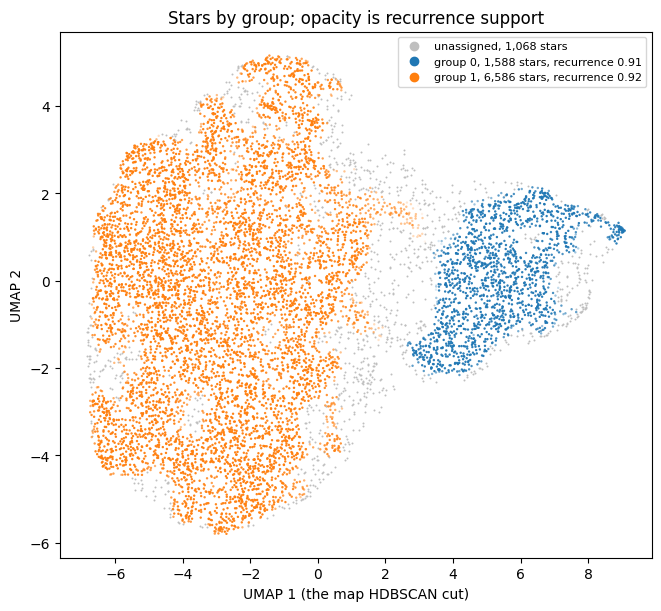

# Tutorial: two groups in the APOGEE DR19 example table, part 1

```{eval-rst}
.. index::
   single: tutorial; APOGEE
   single: dex
   single: group properties
   single: APOGEE table
```

This tutorial runs Starfold on the APOGEE DR19 example table, 9,242 real stars with no labels, and reads the groups in physical units. It follows the notebook `notebooks/02_apogee.ipynb`. Part 2 ({doc}`apogee-checks`) runs the co-association check and the calibration test and ends with what the run supports and what it does not. Read {doc}`digits` and {doc}`digits-refits` first: they explain the same output more slowly, on a table where the true classes are known.

## Goal

You finish this part with a run on a real table: two groups of stars described by measured quantities. You also get two pieces of evidence for how far to trust them, recurrence and the count interval. Part 2 adds co-association and a calibration test.

Treat the run as a check of the method, not as a finding about the Milky Way. The disc of the Milky Way is known to hold two chemical sequences, so a method that finds no structure here, or fifty groups, has a problem. Finding the known split without being told about it passes a sanity check and nothing more.

## Before you start

- A clone of the repository. The table ships with the clone and not with the installed package. Install as in {doc}`../start/install`:

  ```console
  git clone https://github.com/AndreasWNeitzel/starfold && cd starfold
  uv sync --extra bench
  ```

- Run Python from the repository root, so that `bench.datasets` imports.
- Know the words the digits tutorial explains: flag, recurrence, count interval and co-association. If not, read {doc}`digits` and {doc}`digits-refits` first.
- Time: the recorded run took 163 s on a laptop RTX 3060 with RAPIDS cuML (search 140 s, refits 13 s, 334 fits, 1,684 MB peak host memory). The CPU time at this size is not measured. For a quick CPU pass, use a random subsample of 3,000 stars; the recorded numbers below are for all stars.
- The numbers below come from the recorded run with `random_state=0`. A different engine or machine can change the last digits.

## Step 1: load the table and read the columns

Each row is one star. Each column is one number measured or derived for that star. The table comes from two sources.

- APOGEE is an infrared spectroscopic survey of stars in the Milky Way. ASPCAP is its pipeline: it fits each star's spectrum to get chemical abundances. The table keeps stars with a signal-to-noise ratio above 70.
- Gaia is a space telescope that measures star positions and motions. galpy is a Python package that integrates a star's orbit in a model of the Galaxy's gravity. Together they give five orbital quantities.

Load the table and print a summary:

```python
import numpy as np
from bench.datasets import example_table

x, names = example_table()
low, middle, high = np.percentile(x, [5, 50, 95], axis=0)
print(f"{x.shape[0]:,} stars")
for j, name in enumerate(names):
    print(f"{name:8}{middle[j]:>12.4g}{low[j]:>12.4g}{high[j]:>12.4g}")
```

The notebook formats the numbers with units:

```text
9,242 stars
column      median           5 to 95 percent  unit
fe_h        -0.138       -0.559 to     0.224  dex
alpha_m     0.0448      -0.0221 to     0.253  dex
mg_fe       0.0618      -0.0257 to     0.306  dex
J_R           29.4         2.21 to       162  kpc km/s
J_z           11.3        0.724 to        66  kpc km/s
L_z          1,857        1,204 to     2,334  kpc km/s
ecc          0.148       0.0402 to     0.365  
E         -155,907     -172,581 to  -144,186  km^2/s^2
```

What the columns mean:

- `fe_h` is [Fe/H], the iron abundance relative to the Sun. It is in {term}`dex`, a base-10 logarithm: 0 is solar, -1 is a tenth of solar.
- `alpha_m` ([alpha/M]) and `mg_fe` ([Mg/Fe]) say how rich a star is in alpha elements such as magnesium. Stars that formed early and quickly are richer in them.
- `J_R` and `J_z` are orbital actions in kpc km/s (kiloparsec times kilometres per second): how far the orbit swings in and out, and up and down through the disc.
- `L_z` is the angular momentum about the Galaxy's axis. It is large and positive for stars that rotate with the disc.
- `ecc` is the orbital eccentricity, 0 for a circle. `E` is the orbital energy in km^2/s^2, more negative for a more tightly bound star.

The columns have very different scales: `E` runs to about -150,000 and `fe_h` to about 0.2. The next step deals with that.

## Step 2: leave the scaling at its default

A column in km^2/s^2 must not outweigh a column in dex only because its numbers are larger. Starfold rescales every column before {term}`UMAP`. The default {term}`scaling` is `"standard"`: subtract the column mean and divide by the standard deviation, so that each column has mean 0 and variance 1. Starfold fits this scaling inside each refit, so a refit never sees the statistics of rows it did not draw.

```python
import starfold

config = starfold.Config()
```

There is no printed output. If a column carries a unit that makes its spread meaningless, drop the column rather than leave it in. See the how-to guides in {doc}`../howto/index`.

## Step 3: run `recover`

Run the whole procedure with the table and a seed.

```python
result = starfold.recover(x, config=config, random_state=0)
prov = result.provenance
print(
    f"engine {prov['engine_resolved']}, {prov['total_fits']} fits, "
    f"{prov['stage_seconds']['total']:.0f} s, peak host memory {prov['peak_rss_mb']:,.0f} MB"
)
print("fits per stage:", prov["stage_fits"])
```

The recorded run prints:

```text
engine cuml, 334 fits, 163 s, peak host memory 1,684 MB
fits per stage: {'search': 300, 'reference': 2, 'worlds': 32, 'null': 0}
```

The `search` stage runs {term}`Optuna` over settings, `reference` is the fit on all stars, `worlds` is the 32 refits, and `null` is the calibration test. The `null` time is 0 here because the test is off.

The run used the engine you expected. The stage `null` stays at 0 fits until step 10 in {doc}`apogee-checks`.

## Step 4: read the flags

```python
for flag in result.flags:
    print(flag)
```

Four flags are raised:

```text
search_budget_exhausted
consensus_subsampled
consensus_disagrees
null_not_run
```

- `search_budget_exhausted`: all 48 trials ran. A larger `n_trials` may help.
- `consensus_subsampled`: the co-association check ran on a seeded subset of 4,096 stars, because the pair matrices for all 9,242 stars would exceed the 512 MiB budget. Expected at this size.
- `consensus_disagrees`: a second check, which cuts the stars into groups from how often refits put pairs together, gave a different grouping (its score against your labels is below 0.5). Step 8 in {doc}`apogee-checks` explains it.
- `null_not_run`: no calibration test ran, so there is no {term}`p-value`. Step 10 in {doc}`apogee-checks` runs it.

None of the four says the search found nothing. `no_groups_in_reference` and `count_unstable` are absent, so there are groups and the count does not drift.

## Step 5: read the groups

```python
w = result.worlds
print(f"{result.n_groups} groups; {(result.labels < 0).sum():,} of {result.labels.size:,} stars unassigned")
print("interval", w.count_interval[0], "to", w.count_interval[1])
print(f"unresolved mass {result.unresolved_mass:.3f}")
```

The notebook prints the group sizes and recurrence as well:

```text
2 groups; 1,068 of 9,242 stars unassigned
  group 0: 1,588 stars, recurrence 0.914 (5 to 95 percent over refits 0.886 to 0.935)
  group 1: 6,586 stars, recurrence 0.918 (5 to 95 percent over refits 0.879 to 0.938)
groups per refit: 2 in 31 refits, 3 in 1 refits
interval 2 to 2
unresolved mass 0.154
```

Unassigned stars (what the digits tutorial calls {term}`noise`) are stars that no dense region claimed. They are not bad measurements.

- {term}`Recurrence` is how often a group comes back across {term}`refit` fits. Each group is matched with the best-overlapping refit group, and the overlap is the {term}`Jaccard index`. Both groups average above 0.85, the mark that the help page of the R function `clusterboot` (Hennig, R package fpc, [clusterboot help](https://rdrr.io/cran/fpc/man/clusterboot.html)) gives for a highly stable cluster.
- The {term}`count interval` is 2 to 2: 31 of the 32 refits found 2 groups and one found 3. It is a {term}`stability interval`, the range over refits. It is not a {term}`confidence interval` for a true number of groups.
- The {term}`unresolved mass` is 0.154: on average, 15 percent of a star's refit outcomes were "no group".

The chosen {term}`setting` is worth a look too:

```python
def show(value):
    return f"{value:.3g}" if isinstance(value, float) else str(value)


settings = (result.params, result.deployed_params, result.default_params)
print(f"{'':18}{'on subsets':>12}{'all stars':>12}{'defaults':>12}")
for field in result.params.to_dict():
    print(f"{field:18}" + "".join(f"{show(getattr(s, field)):>12}" for s in settings))
```

The notebook prints a table of three columns:

```text
                    on subsets   all stars    defaults
n_neighbors                 54          54          15
min_dist                 0.289       0.289         0.1
n_components                 2           2           2
min_cluster_size            72          90           5
min_samples                 24          30           5
selection_method           eom         eom         eom
```

The search chose a much larger `n_neighbors` (54) than the default (15), and a larger `n_neighbors` emphasises broad structure over fine detail. Because `n_components` is 2, the map in the next step is the map HDBSCAN cut.

## Step 6: draw the map

The notebook refits the chosen setting on all stars with the same seed and checks that it gives the same groups, so the picture is the map HDBSCAN cut. Draw it with the notebook cell "The map". The figure shows the result.



Every dot is one star. The axes are UMAP 1 and UMAP 2 and have no units: only which stars sit near which stars counts. The large orange island on the left is group 1 (6,586 stars). The smaller blue island on the right is group 0 (1,588 stars). Grey dots are unassigned stars (1,068), and they sit around the edges and in the bridge between the islands. A dot's opacity is its {term}`own support`. The stars on the orange side of the bridge, near UMAP 1 of 2, are faint: the refits did not keep them with the orange group.

A good picture has compact islands with solid dots and a clear gap. A bad picture is one mixed cloud, or many small islands of different colours. Here the two islands are distinct but touch through the bridge, so the boundary between groups is not sharp.

The map has no units, so it cannot say what a region is. The same map, coloured once by each column, does.

![Eight copies of the map, each coloured by one column: [Fe/H], [alpha/M], [Mg/Fe], J_R, J_z, L_z, eccentricity and E.](../figures/manual/02_02.png)

Each panel uses the same map and a colour scale from dark purple (low) to yellow (high) for one column, clipped at the 2nd to 98th percentile. The right island is bright in [alpha/M], [Mg/Fe], `J_R`, `J_z` and eccentricity, and dark in [Fe/H] and `L_z`. In the left island, `L_z` and `E` change smoothly from top to bottom, so group 1 is itself a gradient and not one point.

The two islands differ in measured quantities, as a real split would. The smooth gradient inside group 1 is a reason not to read it as one tight population.

## Step 7: read the groups in physical units

For each group, Starfold matches it to its best refit group in every refit and takes the median of each column. The table gives the median of those medians over 32 refits, the 5 to 95 percent range, and the median of all stars. All are in the original units. The range shows how much a group's median moves when the stars are resampled. It does not show how wide the group is.

```python
kept = x[result.kept_rows]
median, band = w.property_median, w.property_band
for i in range(result.n_groups):
    print(f"group {i}: median over refits (5 to 95 percent), then all stars")
    for j, name in enumerate(names):
        print(f"  {name:8}{median[i, j]:>10.4g} ({band[i, j, 0]:.4g} to {band[i, j, 1]:.4g}){np.median(kept[:, j]):>12.4g}")
```

The notebook formats the numbers and adds the unit:

```text
group 0: median over refits (5 to 95 percent), then all stars
  fe_h       -0.416 (-0.424 to -0.405)     -0.138  dex
  alpha_m     0.222 (0.221 to 0.224)     0.0448  dex
  mg_fe       0.273 (0.271 to 0.275)     0.0618  dex
  J_R          79.3 (76 to 82.2)       29.4  kpc km/s
  J_z          32.6 (31.4 to 33.7)       11.3  kpc km/s
  L_z         1,474 (1,464 to 1,485)      1,857  kpc km/s
  ecc          0.26 (0.254 to 0.265)      0.148  
  E        -163,784 (-164,177 to -163,230)   -155,907  km^2/s^2
group 1: median over refits (5 to 95 percent), then all stars
  fe_h      -0.0758 (-0.0796 to -0.0709)     -0.138  dex
  alpha_m    0.0258 (0.0247 to 0.0272)     0.0448  dex
  mg_fe      0.0404 (0.0388 to 0.0418)     0.0618  dex
  J_R          23.4 (23 to 23.8)       29.4  kpc km/s
  J_z          8.55 (8.36 to 8.66)       11.3  kpc km/s
  L_z         1,926 (1,922 to 1,935)      1,857  kpc km/s
  ecc          0.13 (0.128 to 0.131)      0.148  
  E        -154,301 (-154,408 to -154,095)   -155,907  km^2/s^2
```

The Milky Way disc has two chemical sequences in the [Fe/H] against [Mg/Fe] plane (Bensby et al. 2014, doi:10.1051/0004-6361/201322631; Hayden et al. 2015, doi:10.1088/0004-637X/808/2/132). The high-alpha sequence holds older, metal-poorer stars on hotter orbits, with lower `L_z` and larger `J_R`, `J_z` and eccentricity. The low-alpha sequence reaches solar [Fe/H] and above on cooler, more circular orbits. Starfold was told none of this. Group 0 has the high-alpha pattern (low [Fe/H], high [Mg/Fe], low `L_z`, high `J_R`, `J_z` and `ecc`). Group 1 has the reverse.

![Left, every star in the [Fe/H] against [Mg/Fe] plane with each group's median. Right, each group's median in every column, in standard deviations from the table mean.](../figures/manual/02_03.png)

In the left panel, the horizontal axis is [Fe/H] in dex and the vertical axis is [Mg/Fe] in dex. Blue dots (group 0) sit upper left and orange dots (group 1) sit lower right. The large circles mark the group medians, and their error bars are too small to see. The two clouds touch around [Fe/H] of -0.25. In the right panel, the horizontal axis lists the eight columns and the vertical axis is the group median minus the table mean, in standard deviations. Group 0 sits at about +1.7 in [alpha/M] and [Mg/Fe], about -1.1 in [Fe/H], about -0.9 in `L_z` and about -0.8 in `E`. Group 1 sits between about -0.55 and +0.32 in every column. The dotted line is the table mean.

A good picture has medians far apart relative to their bars. Here the bars are much narrower than the distance between the groups.

The bars are stability intervals over refits, not confidence intervals. They contain no measurement error, because the table has no per-star uncertainties. If your table has them, pass them to `recover` as `X_err`.

## What you learned

- Read a real table in units: the columns, what dex means, and why Starfold standardises.
- Two groups recur (0.91 and 0.92), the count interval is 2 to 2, and the unresolved mass is 0.154.
- The group medians follow the two known disc sequences, although Starfold was told nothing about them.
- The bars on the medians are stability intervals over refits, without measurement error.

## Next page

Go on to {doc}`apogee-checks`: the co-association check, the copy and the gap, the calibration test and how to report the run.
