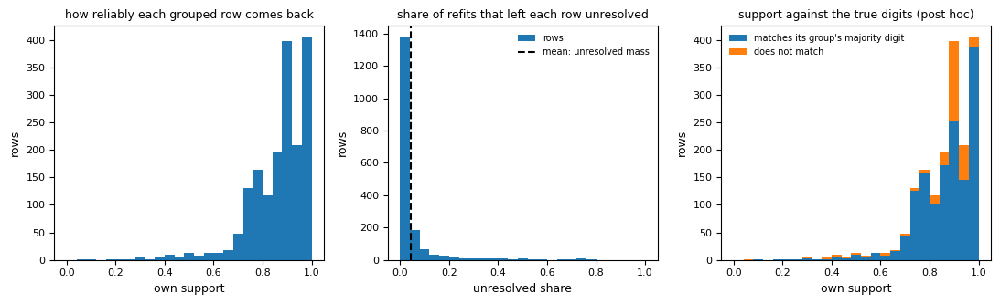
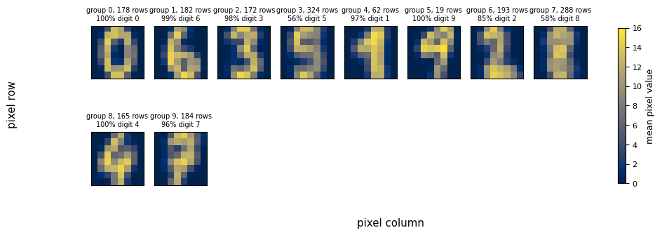

# Tutorial: groups in the scikit-learn digits dataset, part 2

```{eval-rst}
.. index::
   single: tutorial; digits, part 2
   single: recurrence
   single: count interval
   single: post hoc check
   single: save and load
   single: purity
```

This page reads how well the digits groups hold up when the rows are resampled, compares them with the true digits after the fact, and saves the result. It continues {doc}`digits` and follows the second half of the notebook `notebooks/01_digits.ipynb`.

## Goal

You finish with answers to three questions. Which groups come back when the rows are resampled? How many groups does the table support? How did the groups compare with the true digits, which Starfold never saw? You also finish with a saved result.

## Before you start

- Finish {doc}`digits`. Keep the same Python session, because steps 6 to 10 use `result`, `X`, `y` and `starfold` from there.
- If you start a new session, load the recorded run from the clone instead. The saved runs in `notebooks/runs/` ship with the repository, and notebooks 01 and 02 write them. Run Python from the repository root:

  ```python
  import starfold
  from sklearn.datasets import load_digits

  X, y = load_digits(return_X_y=True)
  result = starfold.load("notebooks/runs/digits")
  ```

- The numbers below come from the recorded run with `random_state=0`. A different engine or machine can change the last digits. The run itself took 93.9 s on a laptop RTX 3060 with cuML.

## Step 6: read support

{term}`Support` is per row. Take each refit that drew the row and look at the group the refit gave the row. Record the share of that refit group's members that the full fit puts in a given group. Support for that group is the average of those shares over the refits. It says how often the row stays with its group across refits. {term}`Own support` is the support for the row's own group. The {term}`unresolved mass` is the average share that falls in no group. Either the refit called the row noise, or the rows of its refit group are noise in the full fit. It is averaged over all rows.

```python
w = result.worlds
print(f"unresolved mass: {result.unresolved_mass:.3f}")
print(f"refits that drew each row: {w.n_sampled.min()} to {w.n_sampled.max()}")
print(f"support: shape {result.support.shape}")
```

The recorded run prints:

```text
unresolved mass: 0.044
refits that drew each row: 16 to 31
support: shape (1797, 10)
```

The support matrix has one row per image and one column per group. Support plus the unresolved share sums to 1 on every row that a refit drew. The notebook cell "Support per row" draws three histograms.



In the left panel, the horizontal axis is own support from 0 to 1 and the vertical axis counts rows. Most rows sit between 0.8 and 1.0, with the two tallest bars near 0.9 and 1.0 (about 400 rows each). In the middle panel the horizontal axis is the unresolved share per row. Roughly 1,400 rows sit in the first bin near 0, and the dashed line at 0.044 marks the mean, the unresolved mass. In the right panel, the same histogram as the left is stacked by colour. Blue rows match the majority digit of their group. Orange rows do not.

A good picture has the left histogram piled against 1 and the middle one piled against 0. A bad picture has a long flat left histogram, or a middle histogram with mass near 1, which would mean the groups describe a minority of the rows. The flag `high_unresolved_mass` is raised above 0.5. Here 0.044 is far below it.

The right panel is a warning against reading support as truth. Purity is the share of a group's rows that show the group's most common digit (post hoc). Orange rows appear even at own support near 0.9. A row can come back with its group every time and still be a different digit than most of that group.

In this run, 81 percent of the rows with own support of 0.9 or more match their group's majority digit, against 83 percent of all 1,767 grouped rows. High own support did not raise purity here.

So keeping only rows with high own support removes the rows near the edges of groups and does not make the sample purer. Support measures how often a row stays with its group across refits. It is not a purity and not a probability. See {doc}`../metrics/support`, {doc}`../metrics/unresolved` and {doc}`../metrics/strengths` (the within-fit strengths that HDBSCAN reports, which are not probabilities).

## Step 7: read recurrence per group

{term}`Recurrence` is per group. In every refit, Starfold finds the refit group that overlaps the group best and records the {term}`Jaccard index` (rows in both, divided by rows in either). Group recurrence is the mean of that overlap over the refits. The band is the 5th to 95th percentile over refits, a {term}`stability interval`.

```python
for group, (recurrence, (low, high)) in enumerate(
    zip(w.group_recurrence, w.group_recurrence_band, strict=True)
):
    print(f"  group {group:2d}: recurrence {recurrence:.2f} ({low:.2f} to {high:.2f})")
```

The notebook prints the group size too:

```text
  group  0:  178 rows, recurrence 1.00 (1.00 to 1.00)
  group  1:  182 rows, recurrence 1.00 (0.99 to 1.00)
  group  2:  172 rows, recurrence 0.84 (0.12 to 0.99)
  group  3:  324 rows, recurrence 0.54 (0.25 to 0.81)
  group  4:   62 rows, recurrence 0.82 (0.05 to 0.98)
  group  5:   19 rows, recurrence 0.45 (0.02 to 0.94)
  group  6:  193 rows, recurrence 0.77 (0.15 to 1.00)
  group  7:  288 rows, recurrence 0.73 (0.22 to 0.97)
  group  8:  165 rows, recurrence 0.73 (0.13 to 0.99)
  group  9:  184 rows, recurrence 0.70 (0.14 to 0.99)
```


In the left panel, each black dot is a group, with its recurrence on the vertical axis and a bar for its 5 to 95 percent band. The dotted blue line at 0.85 and the dashed orange line at 0.5 are the marks of the R function `clusterboot` (Hennig, R package fpc, [clusterboot help](https://rdrr.io/cran/fpc/man/clusterboot.html)). Its help page calls a mean Jaccard of 0.85 or more highly stable. It says a Jaccard of 0.5 or less in one resample means the cluster dissolved. The middle panel shows group sizes in rows. In the right panel, each dot is a group, coloured by size. Recurrence is on the horizontal axis. The vertical axis is the share of its rows that have the group's majority digit (post hoc).

A good picture has dots near 1 with short bars, as groups 0 and 1 have. A bad picture has dots near or below the dashed line with bars that run down to 0. Group 5 has 19 rows, a recurrence of 0.45 and a band from 0.02 to 0.94: its mean matches the `clusterboot` dissolution mark. Groups 2 to 9 have bars that reach below 0.3, so in some refits their best overlap is poor.

The marks are for reading only, and Starfold removes no group because of them, group 5 included. Only groups 0 and 1 recur almost unchanged. Group 5 (0.45) is below the 0.5 mark. Groups 2, 3, 4, 6, 7, 8 and 9 (0.54 to 0.84) sit between the two marks, so report them as groups whose membership changes with the rows drawn. Group 3 at 0.54 is the clearest case, and {doc}`../metrics/recurrence` says what to do with it. A group can recur and still be impure: the right panel has a large group (group 3, 324 rows) with 56 percent purity.

## Step 8: read the count interval

The {term}`count interval` is the 5th to 95th percentile of the number of groups the 32 refits found, rounded outward to whole numbers. It is a stability interval, not a {term}`confidence interval`.

```python
print(f"refits: {w.count_values.size}; groups found: {w.count_interval[0]} to {w.count_interval[1]}")
```

The recorded run prints:

```text
refits: 32; groups found: 3 to 16
```


The horizontal axis is the number of groups a refit found, and the vertical axis is the share of the 32 refits. The shaded band spans 3 to 16. The tallest bar is at 13 groups (25 percent of refits). The fit on all rows has 10 groups, and only 12.5 percent of refits (4 of 32) found that number. One refit found 19.

A good picture has one narrow peak that contains the count of the full fit. A bad picture is a wide spread, as here. That spread is why `count_unstable` is raised.

Quote the interval, 3 to 16, and not the single count, 10. The interval does not make 10 wrong and does not make it right. The number of arbitrary groups is not identifiable without a declared estimand (the real quantity you are counting, and the assumptions about it). The true count of 10 digits is not the estimand of this run. Never tune settings to reach a count. See {doc}`../metrics/count-interval`.

## Step 9: check afterwards against the true digits

Only now do the true digits enter. The check is post hoc: nothing in the search, the refits or the scores used them. Comparing with them tests the result instead of tuning it. They are labels made by people for a benchmark, and in real use they do not exist. The metric is the coverage-adjusted {term}`adjusted Rand index`: the index on rows that both partitions assign, floored at 0, times the share of rows assigned. 1 means the groups are the digits. 0 means no better than chance. It is computed by `bench.beats_default.coverage_adjusted_ari` (the function the notebook imports):

```python
from bench.beats_default import coverage_adjusted_ari

truth = y[result.kept_rows]
print(f"coverage-adjusted ARI, Starfold: {coverage_adjusted_ari(truth, result.labels):.3f}")
print(f"coverage-adjusted ARI, defaults: {coverage_adjusted_ari(truth, result.default_labels):.3f}")
```

The two scores:

```text
coverage-adjusted ARI, Starfold: 0.740
coverage-adjusted ARI, defaults: 0.594
```

The notebook then draws the mean image of each group, the average of its rows' 8 by 8 pixel images.



Each small square is the average image of one group, 8 pixels by 8 pixels. Brighter is a higher pixel value, 0 to 16. The title of each square gives the group number, its size and the share of its rows with the majority digit. Groups 0, 1, 2 and 4 show a clear 0, 6, 3 and 1 at 97 to 100 percent purity. Group 3 (324 rows) shows a smeared 5 at 56 percent, and group 7 (288 rows) a smeared 8 at 58 percent. Group 5 is 19 rows of 9.

A good picture is one sharp digit per square with a high percentage. A bad picture is a blur, because the group mixes digits. Group 3, the blurriest large group, has the lowest recurrence among the large groups (0.54). Group 7 is blurred too but recurs at 0.73, as pure group 8 does, so recurrence does not separate pure from mixed groups here.

On this table, Starfold's groups agree better with the digits than one fit of the defaults does (0.740 against 0.594). The comparison holds for this table only and makes no general claim about the method. A stable partition is not automatically a true partition, and the digits labels are the only reason you can say anything about truth here.

## Step 10: save and reload

Save the result to a folder and read it back.

```python
import numpy as np

path = starfold.save(result, "runs/digits")
loaded = starfold.load(path)
assert np.array_equal(loaded.labels, result.labels) and loaded.flags == result.flags
print(f"saved to {path}; labels and flags match after reloading")
```

The recorded line prints the full path on the machine that ran it, shortened here:

```text
saved to <folder>/runs/digits; labels and flags match after reloading
```

The folder holds `result.json` (settings, scores, flags and {term}`provenance`), `arrays.npz` (the arrays, read back with `allow_pickle=False`, so nothing executable is stored) and a manifest of SHA-256 checksums. `starfold.load` checks the checksums and derives the flags again from the arrays. A file whose stored flags differ is refused.

Keep the folder with the script and the seed. Together they make the run reproducible, and anyone can read the result without refitting.

## What you learned

- A run ends in flags, a count interval, recurrence per group and support per row. Read them in that order.
- Ten groups were found. Two of them (0 and 1) recur almost exactly, seven sit between the `clusterboot` marks (0.54 to 0.84), and one (group 5, 0.45) has a mean that matches the 0.5 dissolution mark.
- The count is not stable: 3 to 16 groups across refits. Quote the interval.
- High own support did not give a purer sample in this run (0.81 against 0.83).
- The true digits check the result after the fact and never tune it.
- The calibration test was not run, so nothing in this tutorial says whether a table with no groups would look as good. The APOGEE tutorial runs that test on a real table.

Look up a number on its own page:

| Number | Page |
|---|---|
| Score terms | {doc}`../metrics/prediction-agreement`, {doc}`../metrics/coverage`, {doc}`../metrics/modularity` |
| Score, gap, defaults | {doc}`../metrics/score`, {doc}`../metrics/gap`, {doc}`../metrics/default-comparison` |
| Reproducibility | {doc}`../metrics/recurrence`, {doc}`../metrics/support`, {doc}`../metrics/unresolved`, {doc}`../metrics/count-interval` |
| Checks | {doc}`../metrics/coassociation`, {doc}`../metrics/calibration-p` |
| Within-fit and group values | {doc}`../metrics/strengths`, {doc}`../metrics/properties` |

## Next page

Go on to {doc}`apogee`, a real table with no labels at all. To finish one task on your own table, see the {doc}`../howto/index`.
