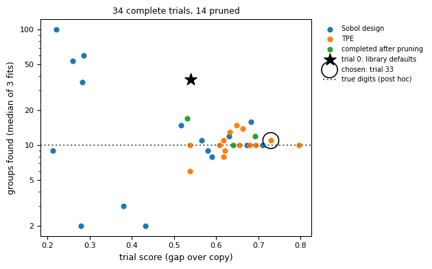

# Tutorial: groups in 1,797 handwritten digits, part 1

```{eval-rst}
.. index::
   single: tutorial; digits
   single: recover
   single: flag
   single: settings search
   single: co-association
```

This tutorial runs Starfold once on 1,797 real images of handwritten digits and reads the first half of the result: the run, the flags, the map and the chosen settings. It follows the notebook `notebooks/01_digits.py`, so you can run the cells there while you read. Part 2 ({doc}`digits-refits`) reads support, recurrence, the group count and the comparison with the true digits, and saves the result.

## Goal

You finish this part with a finished run, an answer to the question "did the run raise a warning?", a map of the groups and the settings the search chose.

## Before you start

- Python 3.11 or 3.12 and a clone of the repository (the notebooks need the clone). The full install page is {doc}`../start/install`. The short version:

  ```console
  git clone https://github.com/AndreasWNeitzel/starfold && cd starfold
  uv sync --extra bench
  ```

- Add `--extra gpu-cu13` or `--extra gpu-cu12` to `uv sync` if you have an NVIDIA GPU and want {term}`cuML` (NVIDIA's GPU versions of UMAP and HDBSCAN). Without it Starfold runs on the CPU.
- Time: the run takes 80.4 s on a laptop RTX 3060 when the run has the GPU to itself. The recorded output shows 182.0 s because notebook 02 ran at the same time (314 fits, 1,428 MB of host memory). The CPU time is not measured, so plan for longer.
- The numbers below come from that recorded run with `random_state=0`. A different engine or machine can change the last digits.

The table is 1,797 {term}`row` entries, one per image, and 64 {term}`column` entries, one per pixel of an 8 by 8 picture. Each pixel value runs from 0 (dark) to 16 (bright).

## Step 1: load the table

Load the images. Keep the true digits in `y`. Starfold never reads `y`.

```python
from sklearn.datasets import load_digits

X, y = load_digits(return_X_y=True)
print(f"{X.shape[0]} images, {X.shape[1]} pixel columns, values {X.min():.0f} to {X.max():.0f}")
print(f"true digits, kept aside: {len(set(y))} classes")
```

You see:

```text
1797 images, 64 pixel columns, values 0 to 16
true digits, kept aside: 10 classes
```

Decision: the table has no missing values in it and needs no cleaning. If yours has missing or infinite values, Starfold drops those rows and raises a flag (you meet flags in step 3).

## Step 2: call `recover`

One call does the whole procedure. Starfold searches for a {term}`setting` with {term}`Optuna`, fits the chosen setting once on all rows, refits it 32 times on random 80 percent subsets, checks the result and raises flags.

```python
import starfold

result = starfold.recover(X, random_state=0)
print(f"groups in the fit on all rows: {result.n_groups}")
```

The run takes minutes (see the time above). You see:

```text
groups in the fit on all rows: 10
```

A {term}`refit` is one more fit of the chosen setting on a random subset with a new {term}`seed`. The fit on all rows gives `result.labels`: one integer per kept row, the group number or -1 for {term}`noise`. Group numbers are names, not ranks.

Decision: ten is the number of groups of one fit. It is not yet a finding. Steps 7 and 8 show how much it moves.

To see what ran, print the provenance:

```python
prov = result.provenance
print(f"engine: asked for {prov['engine_requested']}, used {prov['engine_resolved']}")
print(f"rows kept: {prov['n_kept_rows']} of {prov['n_input_rows']}, columns: {prov['n_features']}")
print("fits per stage:", prov["stage_fits"], "total", prov["total_fits"])
```

You see:

```text
engine: asked for auto, used cuml
rows kept: 1797 of 1797, columns: 64
fits per stage: {'search': 280, 'reference': 2, 'worlds': 32, 'null': 0} total 314
```

Decision: all 1,797 rows were kept, so every row is in the result. Always check that the engine you asked for is the engine used.

## Step 3: read the flags

A {term}`flag` is a short name for one weakness or event in a run. Read the flags before any number.

```python
print(f"{len(result.flags)} of 16 flags raised")
for flag in result.flags:
    print(f"- {flag}")
```

You see:

```text
4 of 16 flags raised
- search_budget_exhausted
- count_unstable
- consensus_disagrees
- null_not_run
```

Read them one at a time.

- `search_budget_exhausted`: all 48 trials ran. This says how the search ended. A larger `n_trials` might find a better setting.
- `count_unstable`: fewer than half of the refits found 10 groups. The count is not reproducible. Step 8 shows by how much.
- `consensus_disagrees`: a second check gave a different grouping. The check counts, for every pair of rows, how often the refits put the pair together ({term}`co-association`), and cuts the rows into groups from those counts. The cut matched your labels with a score of 0.135, below the 0.5 threshold. This is not an error. Read the {term}`contrast` before you conclude anything.
- `null_not_run`: the calibration test did not run, so there is no {term}`p-value`. Expected, because the test is off by default.

For a pair of rows, co-association is the share of the refits that assigned both rows and put them in the same group. The contrast is the mean co-association of pairs inside your groups minus the mean for pairs in different groups. The recorded values are:

```text
within-group co-association:  0.820
between-group co-association: 0.068
contrast:                     0.751
agreement of the cut with labels (ARI times coverage): 0.135
```

Decision: the contrast of 0.751 says pairs inside a group were grouped together far more often than pairs in different groups. The consensus agreement (the cut against your labels, adjusted Rand index times coverage) is 0.135: the cut found 3 groups (the notebook prints `groups in the cut: 3`) where your labels have 10. Both are true at once, so `consensus_disagrees` is a prompt to look, not a verdict. The full list of flags is in {doc}`../reference/flags`.

## Step 4: draw the map

The groups were found in a map of 4 coordinates. A screen has two, so the notebook cell "A picture of the groups" makes one more {term}`UMAP` fit in 2 coordinates for display only. It uses the deployed `n_neighbors` and `min_dist` and draws three panels. You can run that cell, or draw a plain version of the middle panel yourself. In the plain version noise gets a colour and there is no opacity, so it will not match the figure exactly:

```python
import matplotlib.pyplot as plt
import umap
from sklearn.preprocessing import StandardScaler

p = result.deployed_params
layout = umap.UMAP(
    n_neighbors=p.n_neighbors, min_dist=p.min_dist, n_components=2, random_state=0
).fit_transform(StandardScaler().fit_transform(X[result.kept_rows]))
plt.scatter(*layout.T, c=result.labels, s=3, cmap="tab10")
plt.xlabel("display axis 1")
plt.ylabel("display axis 2")
plt.show()
```

The notebook figure looks like this.


Read the figure aloud. Every dot is one image. The axes are display axes with no units and no ticks: only which dots sit near which dots means anything, and the gaps between islands should not be over-read. The left panel colours each dot by its true digit (post hoc, meaning "after the fact"). The middle panel colours each dot by Starfold's group, and a faint dot has low {term}`own support` (the share of refits that kept the row with its group). Grey dots are noise, 30 of them. The right panel shows one fit of the library defaults, with 51 groups.

A good picture has compact islands with mostly solid dots, and few grey dots between them. The middle panel is close to that. A bad picture has islands cut into many small clumps of different colours. The right panel shows it: one fit of the defaults splits several digits into pieces and calls 189 rows noise.

Decision: the map gives you a first look, not a measurement. The numbers in the next steps decide what to trust.

## Step 5: read the settings the search chose

A setting is one complete choice of six values: `n_neighbors`, `min_dist` and `n_components` for UMAP, and `min_cluster_size`, `min_samples` and `selection_method` for {term}`HDBSCAN`. Print the chosen setting, the one that made `labels`, and the library defaults:

```python
columns = {
    "chosen": result.params,
    "deployed": result.deployed_params,
    "defaults": result.default_params,
}
print(f"{'setting':<20}" + "".join(f"{name:>12}" for name in columns))
for name in result.params.to_dict():
    row = "".join(f"{p.to_dict()[name]:>12.3f}" if isinstance(p.to_dict()[name], float)
                  else f"{p.to_dict()[name]:>12}" for p in columns.values())
    print(f"{name:<20}{row}")
```

You see:

```text
setting                   chosen    deployed    defaults
n_neighbors                   13          13          15
min_dist                   0.262       0.262       0.100
n_components                   4           4           2
min_cluster_size              11          14           5
min_samples                    9          11           5
selection_method             eom         eom         eom
```

The `chosen` column is the setting as searched, on 80 percent subsets. The `deployed` column is the setting fitted on all rows: `min_cluster_size` and `min_samples` count rows, so they are scaled up by the ratio of the row counts.

Next, the search summary and the candidates that Starfold scored again on fresh subsets (the {term}`fresh re-score`):

```python
s = result.search
print(f"trials run: {len(s.trials)} of 48; stop reason: {s.stop_reason}")
print(f"fresh gap: chosen {s.gap_selected:.3f}, defaults {s.gap_default:.3f}")
print(f"beats the defaults under the objective: {s.beats_default_under_objective}")
```

You see:

```text
trials run: 48 of 48; stop reason: budget
fresh gap: chosen 0.661, defaults 0.565
beats the defaults under the objective: True
```

Every {term}`trial` got a {term}`score`, a number built from {term}`prediction agreement`, {term}`coverage` and {term}`modularity`. Starfold then scored the same setting on a {term}`structureless copy` of the table and subtracted it. The difference is the {term}`gap`, and the search tries to make the gap large. The score never reads the number of groups. The figure plots the trials.



Read it aloud. Each dot is one finished trial. The horizontal axis is the gap (the figure labels it "trial score (gap over copy)"). The vertical axis is the number of groups its fits found, on a logarithmic scale. Blue dots are the Sobol design, orange dots are TPE proposals, green dots are pruned trials finished at the end. The star is the library defaults, between 30 and 40 groups, at a gap near 0.54. The ring is the chosen trial 33. The dotted line at 10 is the true number of digits (post hoc).

Look at the shape, not at one dot. Trials with a low gap (left) scatter from 2 to 100 groups. Trials with a high gap (right) gather between about 8 and 16. A good picture of a search has high gaps that agree on a count. A bad picture has high gaps at widely different counts, which would mean the table supports many readings.

Decision: the chosen setting beat the defaults on the fresh gap, 0.661 against 0.565. The fresh re-score reduces the winner's curse (the best of many noisy scores is partly luck) but does not remove it. The six paired differences between them were `[0.087, 0.032, 0.075, 0.004, 0.045, -0.016]`, and one is negative. The flag `default_within_noise` was not raised, but its noise estimate treats six overlapping pair differences as independent, so read it as a coarse screen and the margin as small. See {doc}`../metrics/score`, {doc}`../metrics/gap` and {doc}`../metrics/default-comparison`.

## What you learned

- A run ends in flags first. Read them before any number.
- Four of 16 flags were raised. None says the search found nothing, and `consensus_disagrees` is read together with the contrast.
- The group count of one fit (10) is not yet a finding.
- The search chose a setting that beat the defaults on the fresh gap, by a small margin.

## Next page

Go on to {doc}`digits-refits`: support, recurrence, the group count, the comparison with the true digits, and saving the result.
